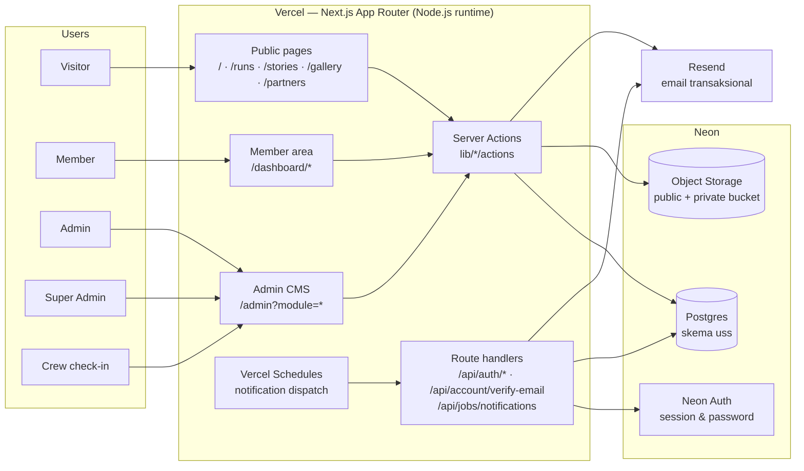
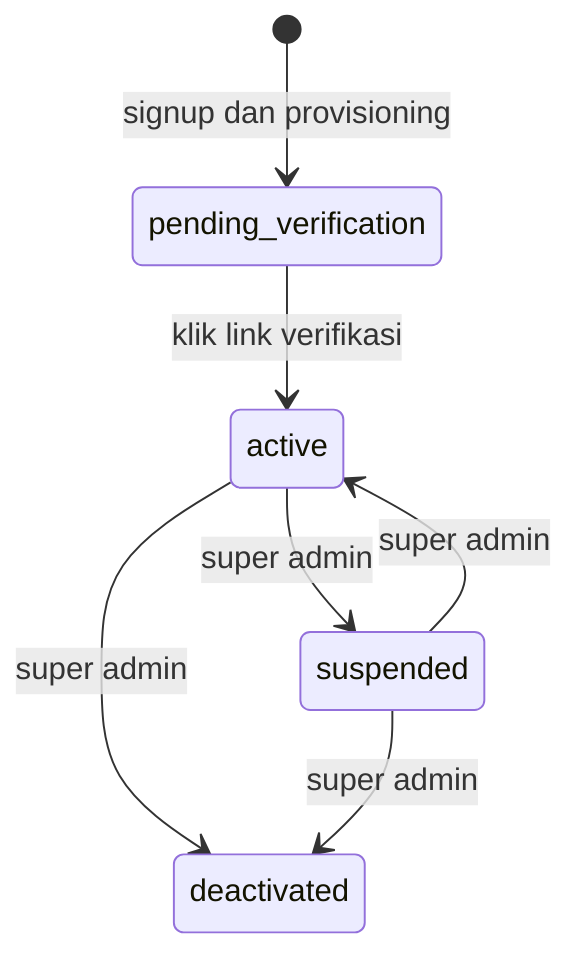
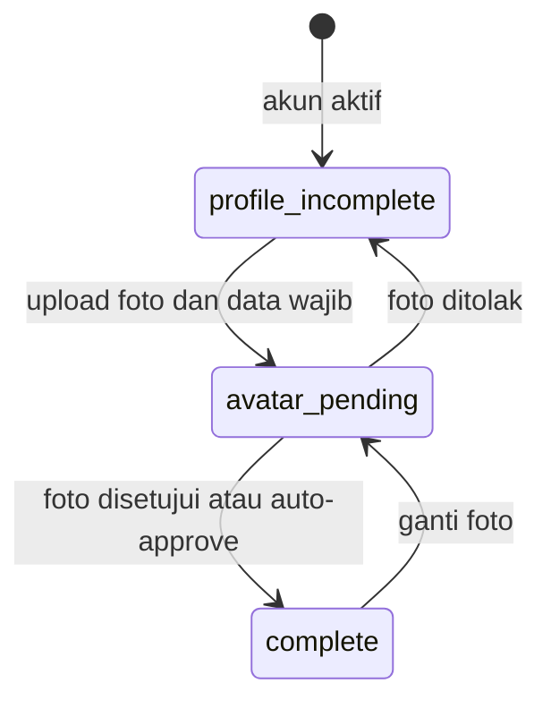
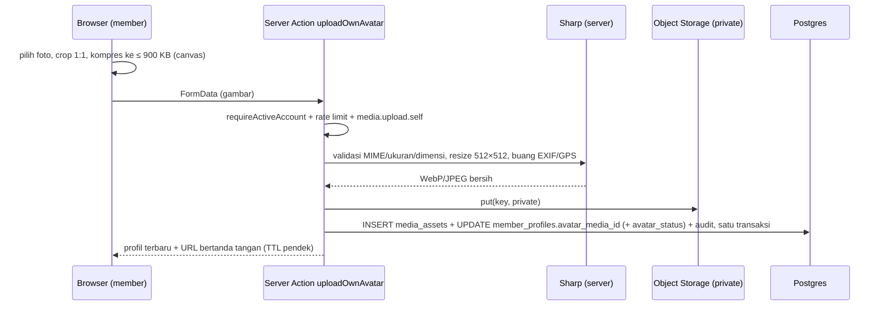
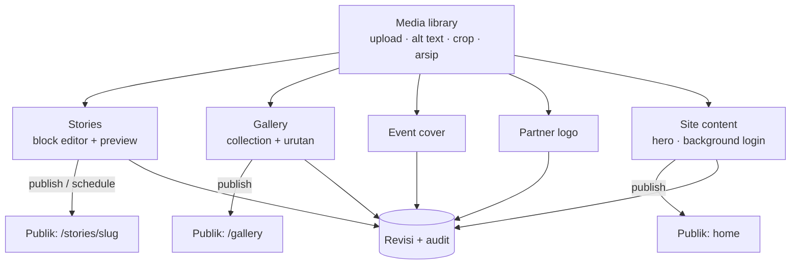
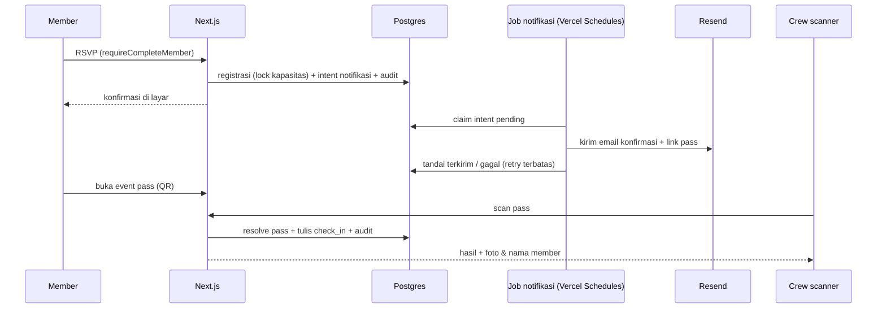

# USS Running — Arsitektur Saat Ini & Target Go-Live

Status: **Draft disetujui untuk eksekusi** · Tanggal: 2026-11-26 · Pasangan dokumen: [GO-LIVE-DELIVERY-PLAN.md](GO-LIVE-DELIVERY-PLAN.md)

Dokumen ini menjelaskan arsitektur USS Running Web sebagaimana adanya hari ini (hasil audit kode, konfigurasi Vercel dan situs live pada commit `9fe7ccb`) dan arsitektur target yang harus dicapai sebelum go-live. Aturan engineering permanen tetap di [AGENTS.md](../AGENTS.md); status task historis tetap di [ENGINEERING-ROADMAP.md](ENGINEERING-ROADMAP.md); kebutuhan produk dasar di [PRD-USS-RUNNING.md](PRD-USS-RUNNING.md).

---

## 1. Ringkasan

USS Running Web adalah satu aplikasi Next.js (App Router) di Vercel dengan empat produk di dalamnya:

1. **Komunitas / Membership** — akun gratis, USS ID permanen, barcode member, **foto profil wajib**.
2. **Media / Editorial** — Stories, gallery, dan media library yang dikelola penuh dari CMS (**wajib**).
3. **Event** — run/event dinamis, RSVP berkapasitas, event pass, check-in.
4. **Partnership** — portofolio brand/partner dan sponsorship event.

Dikelola oleh dua peran operasional: **admin** (operasional konten & event) dan **super admin** (akun, role, pengaturan global, audit penuh).

Prinsip arsitektur yang tidak berubah:

- Server adalah otoritas: izin, validasi dan state lifecycle selalu dicek di server dan database.
- Batas domain dijaga: identitas akun ≠ kredensial auth; barcode member ≠ event pass; registrasi ≠ kehadiran; role ≠ permission; metadata media ≠ binary media; draft ≠ published.
- Semua konten yang bisa berubah ada di database/CMS, semua rahasia di environment variable.
- Setiap aksi admin penting tercatat di audit log yang append-only.

---

## 2. Kondisi saat ini (snapshot audit 2026-11-26)

### 2.1 Stack & deployment

| Lapisan | Teknologi | Status |
| --- | --- | --- |
| Framework | Next.js 16.3.8, React 19.2.6, TypeScript | Berjalan |
| Hosting | Vercel project `ussrunning-web` (team `elevation-junkies`), deploy otomatis dari `main` | Production = `9fe7ccb`, READY |
| Database | Neon Postgres, skema `uss` (19 migration di repo) | Menurut dokumentasi hanya **001–009** yang sudah diterapkan di Neon |
| Auth | Managed Neon Auth (`@neondatabase/auth` 0.5.0-beta), proxy `/api/auth/[...path]` | Endpoint live merespons |
| Email | Resend (`resend` 6.13.0) | **Belum dikonfigurasi** (API key & sender tidak ada) |
| Object storage | Neon Object Storage via S3 SDK (`neon-s3-provider.ts`) | Kode ada, **env belum ada** → upload gagal tertutup |
| QR | `qrcode` (render), `qr-scanner` (scan) | Berjalan di kode |
| Test | Node test runner + PGlite, script browser Playwright | CI menjalankan typecheck, test, build |

### 2.2 Environment variable di Vercel

Script `npm run prod:ready` mewajibkan 16 variabel. Yang ada di Vercel saat audit: `DATABASE_URL`, `NEON_AUTH_BASE_URL`, `NEON_AUTH_COOKIE_SECRET`, `APP_BASE_URL` (production saja).

Belum ada: `RESEND_API_KEY`, `EMAIL_FROM_ADDRESS`, `USS_SUPER_ADMIN_EMAIL`, `EVENT_PASS_TOKEN_KEYS`, `EVENT_PASS_TOKEN_KEY_ID`, `AWS_ENDPOINT_URL_S3`, `AWS_REGION`, `AWS_ACCESS_KEY_ID`, `AWS_SECRET_ACCESS_KEY`, `MEDIA_PUBLIC_BUCKET_NAME`, `MEDIA_PRIVATE_BUCKET_NAME`, `MEDIA_PRIVATE_URL_TTL_SECONDS`.

### 2.3 Apa yang sudah jalan vs belum

| Area | Backend | Frontend | Live |
| --- | --- | --- | --- |
| Signup + provisioning akun | ✅ | ✅ | ✅ akun terbentuk, status `pending_verification` |
| Verifikasi email USS | ✅ | ✅ | ❌ email tidak terkirim (Resend belum dikonfigurasi) |
| Profil member | ✅ | ✅ | ❌ terkunci karena tidak ada akun aktif |
| Foto profil | ⚠️ kolom opsional, upload hanya untuk admin | ❌ tidak ada UI upload | ❌ |
| Member ID & barcode | ✅ otomatis & immutable (format `USS-<UUID>`) | ✅ kartu + QR SVG | ❌ terkunci |
| RBAC member/admin/super_admin | ✅ | ✅ (visibilitas menu) | ❌ belum ada admin aktif |
| Manajemen user (suspend/aktifkan) | ✅ BE-17 | ❌ direktori read-only | ❌ |
| Manajemen role | ✅ migration 019 | ❌ | ❌ |
| Stories / Gallery / Partners / Site content CMS | ✅ | ✅ editor | ❌ publik "temporarily unavailable" |
| Media library & upload | ✅ service | ❌ placeholder | ❌ |
| Event, RSVP, pass, check-in | ✅ | ✅ | ⚠️ data event masih dummy |
| Email notifikasi event | ✅ intent tersimpan | ❌ tidak ada worker/UI | ❌ tidak pernah terkirim |
| SEO dasar | — | ❌ judul sama di semua halaman, tanpa OG/sitemap/robots/favicon | ❌ |

### 2.4 Utang teknis yang mempengaruhi arsitektur

- **Dua sistem paralel**: kode lama (`lib/session.ts`, `lib/admin.ts`, `app/admin/actions.ts`, `app/dashboard/actions.ts`, `components/admin/AdminWorkspace.tsx`, `components/cms/Workspace.tsx`, `components/cms/DemoProvider.tsx`, `components/cms/PublicContent.tsx`) masih membaca/menulis `public.user_profiles` dan data demo. Home dan login masih membaca run dummy dari `lib/content.ts`, sedangkan `/runs` memakai service event baru → data tidak konsisten.
- **Batas ukuran upload**: tidak ada `next.config`, sehingga body Server Action memakai batas default Next.js (1 MB), dan Vercel Functions membatasi body request 4,5 MB. Sementara `MEDIA_MAX_UPLOAD_BYTES` default 10 MB. Desain upload harus memperhitungkan ini (lihat §6.3).
- **Super admin pertama** hanya bisa dibuat lewat SQL manual: `USS_SUPER_ADMIN_EMAIL` divalidasi oleh `prod:ready` tapi tidak dipakai kode, dan `uss.manage_role` mensyaratkan aktor yang sudah super_admin.
- **Dokumentasi drift**: roadmap belum mencatat BE-18 (`a55dcba`), readiness gate (`b5fb90d`), storage adapter (`057eb0d`) dan members directory (`9fe7ccb`).

---

## 3. Arsitektur target — konteks sistem



Catatan:

- Satu aplikasi, satu deployment. Tidak ada service terpisah sebelum ada kebutuhan nyata.
- Semua mutasi lewat **Server Action** atau **route handler** di runtime Node.js, tidak ada akses database dari browser.
- Pengiriman email notifikasi dipindah ke luar request user: intent disimpan di `uss.notification_deliveries`, lalu dikirim oleh job terjadwal (Vercel Schedules) yang memanggil route handler terlindungi.
- Email verifikasi akun tetap dikirim langsung saat signup/resend karena user sedang menunggu.

---

## 4. Lapisan kode

```text
app/                      Routing, layout, halaman (RSC). Tipis: panggil feature/domain, tidak berisi SQL.
features/<modul>/         UI per modul (komponen, model presentasi, adapter action). Tidak berisi SQL.
components/ui/            Design system bersama (Button, Field, Modal, Toast, ...).
lib/<domain>/
  *-actions.ts            Server Actions — pintu masuk dari UI, mengembalikan Result {ok, code}.
  *-service.ts            Aturan bisnis + otorisasi (requirePermission / requireActiveAccount).
  *-validation.ts         Validasi input server (sumber kebenaran).
  *-repository.ts         SQL terparameter, transaksi, lock.
  *-types.ts / *-errors.ts DTO dan kode error stabil.
lib/authz/                Matriks permission (kode) + guard.
lib/db/                   Akses Neon (HTTP driver, batch transaction).
database/migrations/      Migration berurutan, additive, tercatat checksum.
scripts/                  Migrasi, readiness, bootstrap operasional.
```

Aturan tambahan untuk fase go-live:

1. Kode lama di §2.4 **dihapus**, bukan dibiarkan berdampingan. Tidak ada lagi pembacaan `public.*` atau `lib/content.ts` dari halaman publik.
2. Setiap modul publik membaca lewat fungsi `listPublic*/getPublic*` yang hanya mengembalikan konten published.
3. Fallback demo hanya boleh ada di halaman referensi development (`/design-system`), tidak di halaman publik.

---

## 5. Domain & kepemilikan data

| Domain | Tabel utama | Permission | Catatan target |
| --- | --- | --- | --- |
| Akun & lifecycle | `accounts`, `email_verification_tokens` | sistem; `users.manage` | Status: `pending_verification → active → suspended/deactivated` |
| Profil member | `member_profiles` | `profile.*.self`; baca admin: `members.read` (baru) | Foto profil wajib, lihat §6 |
| Identitas member | `accounts.member_id`, `accounts.barcode_value` | `member_card.read.self`; lookup: `members.lookup` (baru) | Format ID manusiawi, lihat §6.2 |
| Role & izin | `roles`, `account_roles` | `roles.manage` (super_admin) | Bootstrap super admin via script |
| Media | `media_assets` | `cms.content.manage`; self-upload avatar: `media.upload.self` (baru) | Binary di object storage |
| Stories | `stories`, `story_revisions`, `categories`, `tags`, `story_tags`, `story_partners`, `story_content_types` | `cms.content.manage` / `stories.manage` | Body jadi block-based (jsonb sudah mendukung) |
| Gallery | `galleries`, `gallery_items`, `gallery_revisions` | `cms.content.manage` | Halaman publik `/gallery` |
| Site content | `site_content`, `site_content_revisions` | `cms.content.manage` | Home 100% dari sini |
| Partner | `partners`, `partner_revisions`, `event_partners` | `partners.manage` | — |
| Event | `events`, `event_revisions`, `event_custom_fields` | `events.manage` | — |
| Registrasi | `event_registrations`, `registration_field_values` | self; kelola: `events.manage` | Export CSV untuk admin |
| Event pass & check-in | `event_passes`, `check_ins`, `check_in_scan_limits` | self; scan: `events.manage` | Scanner menampilkan foto member |
| Notifikasi | `notification_templates`, `notification_deliveries` | `settings.manage` / sistem | Worker terjadwal |
| Audit | `audit_logs` | `audit.read`, `audit.read.all` | Append-only |

### 5.1 Matriks role target

| Permission | member | admin | super_admin |
| --- | :-: | :-: | :-: |
| `profile.read.self`, `profile.update.self`, `member_card.read.self` | ✅ | ✅ | ✅ |
| `media.upload.self` (baru, avatar sendiri) | ✅ | ✅ | ✅ |
| `cms.content.manage`, `stories.manage`, `partners.manage`, `events.manage` | | ✅ | ✅ |
| `members.read` (baru, data terbatas tanpa kontak darurat) | | ✅ *(menunggu keputusan K-03)* | ✅ |
| `members.lookup` (baru, scan barcode member) | | ✅ | ✅ |
| `avatars.moderate` (baru) | | ✅ | ✅ |
| `audit.read` | | ✅ | ✅ |
| `audit.read.all`, `users.manage`, `roles.manage`, `settings.manage` | | | ✅ |

Permission tetap didefinisikan di kode (`lib/authz/permissions.ts`), bukan di database, sampai ada kebutuhan role kustom.

---

## 6. Identitas member (kebutuhan inti)

### 6.1 Lifecycle akun + gerbang profil lengkap

Lifecycle akun (`accounts.status`):



Kelengkapan profil di dalam akun `active` (dihitung server, bukan status akun baru):



- `accounts.status` **tidak ditambah state baru**. "Profil lengkap" adalah kondisi turunan yang dihitung server dari profil + status foto.
- Guard baru `requireCompleteMember()` di atas `requireActiveAccount()` dipakai oleh member card, RSVP dan event pass. Halaman profil & upload foto cukup `requireActiveAccount()`.
- Data wajib (usulan, menunggu K-01): nama lengkap, nomor HP, kontak darurat (nama + HP), foto profil.
- Jika moderasi foto diaktifkan (K-01), kolom baru `member_profiles.avatar_status` (`pending_review | approved | rejected`), `avatar_reviewed_by`, `avatar_reviewed_at`, `avatar_rejection_reason`; semua perubahan tercatat di audit log.

### 6.2 Member ID & barcode

- `barcode_value` tetap: UUID acak permanen, opaque, tanpa PII. Dirender sebagai QR dengan logo USS di tengah (error correction H), sesuai PRD §7.
- Member ID dibuat **manusiawi** (usulan K-02): kolom baru `member_number bigint` dari sequence, ditampilkan sebagai `USS-000123`. `member_id` lama tetap ada sebagai identitas internal sampai dipensiunkan; karena belum ada member nyata, backfill dilakukan sekali di migration terkontrol.
- Barcode **bukan** kredensial: scan barcode member hanya menampilkan identitas (foto, nama, Member ID, status) untuk staff dengan `members.lookup`, tidak memberi akses apa pun.
- Reissue barcode (kartu hilang/bocor) masuk backlog pasca go-live dengan riwayat alias yang teraudit.

### 6.3 Alur upload foto profil



Keputusan teknis:

- Kompresi di browser menjaga payload di bawah batas Server Action 1 MB dan batas body Vercel 4,5 MB. Untuk upload CMS ukuran besar (foto event resolusi tinggi) pakai **presigned PUT langsung ke object storage** lalu finalisasi metadata di server.
- Foto profil disimpan di bucket **private** dan dibaca lewat URL bertanda tangan berumur pendek. Foto profil adalah data pribadi; jika dipakai untuk mencocokkan wajah, perlakukan sebagai data pribadi spesifik menurut UU PDP.
- Hapus akun / tarik persetujuan menghapus referensi avatar dan menjadwalkan penghapusan objek setelah audit referensi.

---

## 7. CMS media (wajib)



- **Media library**: grid dengan pencarian/filter, drag-drop multi upload, alt text wajib untuk gambar publik, crop/ratio preset, status aktif/arsip, info "dipakai di mana".
- **Story body block-based** disimpan di kolom `stories.body` (jsonb, tanpa perubahan skema). Tipe blok awal: `paragraph`, `heading`, `image` (media id + caption), `gallery`, `quote`, `embed` (allowlist: Instagram, YouTube, Strava), `cta`, `divider`. Validasi skema blok di `lib/stories/story-validation.ts`; render publik tanpa `dangerouslySetInnerHTML`.
- **Taksonomi**: CRUD kategori & tag (tabel sudah ada), profil penulis/byline.
- **SEO**: `generateMetadata` per halaman, OG image dari `social_preview_media_id`, `app/sitemap.ts`, `app/robots.ts`, `app/icon.png`, `not-found.tsx` sesuai brand.
- **Cache**: halaman publik di-render server dengan revalidasi berbasis tag (`revalidateTag`) saat publish/unpublish, sehingga konten muncul tanpa redeploy.

---

## 8. Event, notifikasi & check-in



- Event pass tetap terpisah dari barcode member.
- Job notifikasi idempoten (memakai `claim_application_notification` dari migration 017), dilindungi secret header, dan mencatat hasil per delivery.
- Admin mendapat daftar peserta per event, ekspor CSV, dan antrian notifikasi (lihat, kirim ulang, batalkan).

---

## 9. Keamanan, privasi & observabilitas

- **Rate limit** di signup, login, resend verifikasi, upload, dan scan (sebagian sudah ada di DB untuk verifikasi & scan).
- **Anti-bot** di form signup dan newsletter.
- **PII minimum** di log dan audit (sudah menjadi pola; dipertahankan).
- **Hak subjek data**: request export & hapus akun, retensi foto, update Privacy Policy terkait foto profil.
- **Log terstruktur** dengan kode error stabil dan request ID; alert untuk lonjakan error, kegagalan job notifikasi dan kegagalan upload.
- **Header keamanan** (CSP untuk halaman publik, `X-Frame-Options`, `Referrer-Policy`) seragam lewat konfigurasi.

---

## 10. Environment

| Environment | Database | URL | Tujuan |
| --- | --- | --- | --- |
| Local | Neon dev branch atau PGlite (test) | `localhost` | Pengembangan |
| Preview | Neon branch per preview (opsional) | `*.vercel.app` | Review per perubahan, setelah go-live |
| Production | Neon `main` | `ussrunning-web-seven.vercel.app` → `ussrunning.com` | Saat ini juga lingkungan review development |

Sebelum go-live: backup/restore teruji, migration dijalankan lewat `npm run db:migrate` dengan `--status` lebih dulu, `npm run prod:ready` lulus, domain kustom + SPF/DKIM/DMARC aktif.

---

## 11. Keputusan arsitektur

Semua keputusan di bawah **diputuskan pemilik pada 2026-11-26** sesuai rekomendasi.

| ID | Keputusan | Rekomendasi |
| --- | --- | --- |
| K-01 | Aturan foto profil wajib & moderasi | Wajib sebelum kartu/RSVP; auto-approve dengan opsi admin menolak setelahnya |
| K-02 | Format Member ID | `member_number` sequence, tampil `USS-000123` |
| K-03 | Admin boleh melihat daftar member | Ya, read-only tanpa kontak darurat & tanpa email lengkap |
| K-04 | Bahasa situs | Bahasa Inggris untuk publik (sudah), Bahasa Indonesia untuk teks bantuan CMS; i18n setelah go-live |
| K-05 | Data & tabel lama `public.*` | Dipensiunkan (data masih dummy) |
| K-06 | Verifikasi email | Hanya link USS via Resend; OTP Neon Auth tetap nonaktif |
| K-07 | Alur delivery sampai go-live | Langsung ke `main` (keputusan pemilik 2026-11-26), dengan validasi wajib sebelum push |
