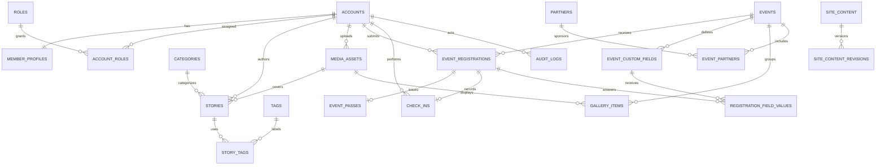

# ERD & Data Architecture — USS Running

Status: Proposed production schema
Database: PostgreSQL / Neon
Principles: normalized core entities, UUID primary keys, server-issued identities, auditable mutations, dynamic CMS configuration, no business-critical client-only state.

## 1. High-level ERD

## 2. Core identity tables

### `accounts`
Purpose: application-owned identity profile mapped to the authentication provider.

Columns:
- `id uuid pk default gen_random_uuid()`
- `auth_provider_user_id text unique not null`
- `email citext unique not null`
- `member_id text unique not null`
- `barcode_value text unique not null`
- `status account_status not null default 'active'`
- `display_name text`
- `created_at timestamptz not null default now()`
- `updated_at timestamptz not null default now()`
- `last_login_at timestamptz`

Rules:
- `member_id` and `barcode_value` are generated server-side inside the account provisioning transaction.
- Auth provider identity is the source of authentication, while `accounts` is the source of application identity.
- Never use `barcode_value` as a permission credential.

Indexes:
- unique `auth_provider_user_id`
- unique lower-case email via `citext`
- unique `member_id`
- unique `barcode_value`
- `(status)` if administrative filtering becomes large enough

### `member_profiles`
Purpose: mutable member data separated from immutable account identity.

Columns:
- `account_id uuid pk fk accounts(id) on delete cascade`
- `full_name text not null`
- `phone text`
- `birth_date date`
- `gender text`
- `city text`
- `emergency_contact_name text`
- `emergency_contact_phone text`
- `instagram_handle text`
- `jersey_size text`
- `running_preferences jsonb not null default '{}'::jsonb`
- `avatar_media_id uuid fk media_assets(id)`
- `marketing_consent boolean not null default false`
- `privacy_consent_at timestamptz`
- `created_at timestamptz not null default now()`
- `updated_at timestamptz not null default now()`

Notes:
- Optional enumerations such as gender/jersey size should be backed by validated configuration if admins need to change available choices.
- `running_preferences` is intentionally flexible for low-risk preference metadata. Business-critical searchable fields should be promoted to explicit columns later.

## 3. Roles and authorization

### `roles`
Columns:
- `id uuid pk`
- `code text unique not null` (`super_admin`, `admin`, `member`)
- `name text not null`
- `description text`
- `system_locked boolean not null default true`

### `account_roles`
Columns:
- `account_id uuid fk accounts(id)`
- `role_id uuid fk roles(id)`
- `granted_by uuid fk accounts(id)`
- `granted_at timestamptz not null default now()`
- primary key `(account_id, role_id)`

Initial policy:
- Public signup receives `member` only.
- `super_admin` role assignment requires existing super admin authorization.
- If future granular permissions are required, add `permissions` and `role_permissions` without changing account identity.

## 4. CMS and site configuration

### `site_content`
Purpose: logical editable site sections.

Columns:
- `id uuid pk`
- `key text unique not null`
- `content jsonb not null`
- `status content_status not null default 'draft'`
- `published_revision_id uuid`
- `updated_by uuid fk accounts(id)`
- `created_at timestamptz`
- `updated_at timestamptz`

Examples of `key`:
- `homepage.hero`
- `homepage.featured`
- `login.visual`
- `footer.global`
- `navigation.primary`

### `site_content_revisions`
Columns:
- `id uuid pk`
- `site_content_id uuid fk site_content(id)`
- `version integer not null`
- `content jsonb not null`
- `status content_status not null`
- `created_by uuid fk accounts(id)`
- `created_at timestamptz not null default now()`

Constraints:
- unique `(site_content_id, version)`

Reasoning:
- Revision records enable draft/publish, rollback-by-new-revision and change history without overwriting the only copy.

## 5. Editorial model

### `categories`
- `id uuid pk`
- `slug text unique not null`
- `name text not null`
- `is_active boolean not null default true`
- `sort_order integer not null default 0`

### `stories`
- `id uuid pk`
- `slug text unique not null`
- `title text not null`
- `excerpt text`
- `body jsonb not null`
- `category_id uuid fk categories(id)`
- `cover_media_id uuid fk media_assets(id)`
- `author_account_id uuid fk accounts(id)`
- `status story_status not null default 'draft'`
- `featured boolean not null default false`
- `seo_title text`
- `seo_description text`
- `publish_at timestamptz`
- `published_at timestamptz`
- `created_at timestamptz not null default now()`
- `updated_at timestamptz not null default now()`

Indexes:
- unique slug
- `(status, published_at desc)`
- `(featured, status)`
- category/status composite if needed

### `tags`
- `id uuid pk`
- `slug text unique not null`
- `name text not null`

### `story_tags`
- `story_id uuid fk stories(id) on delete cascade`
- `tag_id uuid fk tags(id) on delete cascade`
- primary key `(story_id, tag_id)`

## 6. Media and gallery

### `media_assets`
- `id uuid pk`
- `storage_provider text not null`
- `storage_key text unique not null`
- `public_url text`
- `mime_type text not null`
- `byte_size bigint not null`
- `width integer`
- `height integer`
- `alt_text text`
- `caption text`
- `uploaded_by uuid fk accounts(id)`
- `status media_status not null default 'active'`
- `created_at timestamptz not null default now()`

Rules:
- Binary files live in object storage, not Postgres.
- URL should be derived from storage config where practical, rather than treated as permanent identity.

### `gallery_items`
- `id uuid pk`
- `media_asset_id uuid fk media_assets(id)`
- `event_id uuid fk events(id)` nullable
- `caption text`
- `sort_order integer not null default 0`
- `visible boolean not null default true`
- `created_at timestamptz not null default now()`

## 7. Events

### `events`
- `id uuid pk`
- `slug text unique not null`
- `title text not null`
- `summary text`
- `description jsonb`
- `cover_media_id uuid fk media_assets(id)`
- `starts_at timestamptz not null`
- `ends_at timestamptz`
- `timezone text not null default 'Asia/Jakarta'`
- `venue_name text`
- `location_text text`
- `map_url text`
- `registration_opens_at timestamptz`
- `registration_closes_at timestamptz`
- `capacity integer`
- `waitlist_enabled boolean not null default false`
- `checkin_enabled boolean not null default false`
- `checkin_opens_at timestamptz`
- `checkin_closes_at timestamptz`
- `status event_status not null default 'draft'`
- `visibility event_visibility not null default 'public'`
- `eligibility_config jsonb not null default '{}'::jsonb`
- `created_by uuid fk accounts(id)`
- `created_at timestamptz not null default now()`
- `updated_at timestamptz not null default now()`

Constraints:
- `capacity is null or capacity > 0`
- `ends_at is null or ends_at >= starts_at`
- registration close >= open when both present
- check-in close >= open when both present

Indexes:
- unique slug
- `(status, starts_at)`
- `(registration_opens_at, registration_closes_at)` if operational queries require it

### `event_custom_fields`
- `id uuid pk`
- `event_id uuid fk events(id) on delete cascade`
- `key text not null`
- `label text not null`
- `field_type text not null`
- `required boolean not null default false`
- `options jsonb`
- `sort_order integer not null default 0`
- `active boolean not null default true`
- unique `(event_id, key)`

This enables future per-event fields without adding schema columns for every campaign.

## 8. Registration and capacity model

### `event_registrations`
- `id uuid pk`
- `event_id uuid fk events(id)`
- `account_id uuid fk accounts(id)`
- `status registration_status not null`
- `registered_at timestamptz not null default now()`
- `cancelled_at timestamptz`
- `source text not null default 'web'`
- `admin_note text`
- `created_at timestamptz not null default now()`
- `updated_at timestamptz not null default now()`

Recommended uniqueness strategy:
- One logical registration row per member/event with unique `(event_id, account_id)`, updating controlled status over lifecycle.

Indexes:
- unique `(event_id, account_id)`
- `(event_id, status)`
- `(account_id, registered_at desc)`

Capacity rule:
- Confirmation must occur inside a transaction.
- The server calculates confirmed occupancy and atomically decides `confirmed` vs `waitlisted/rejected` according to event settings.
- Never trust a client-side displayed slot count as the authoritative capacity check.

### `registration_field_values`
- `registration_id uuid fk event_registrations(id) on delete cascade`
- `field_id uuid fk event_custom_fields(id)`
- `value jsonb not null`
- primary key `(registration_id, field_id)`

## 9. Event pass and check-in

### `event_passes`
- `id uuid pk`
- `registration_id uuid unique fk event_registrations(id) on delete cascade`
- `token_hash text unique not null`
- `token_hint text`
- `status pass_status not null default 'active'`
- `issued_at timestamptz not null default now()`
- `expires_at timestamptz`
- `revoked_at timestamptz`

Security:
- Generate opaque random token server-side.
- Prefer storing a cryptographic hash rather than raw token if the lookup flow supports it.
- Barcode/QR renders opaque token, never member email/phone/name.

### `check_ins`
- `id uuid pk`
- `registration_id uuid unique fk event_registrations(id)`
- `event_id uuid fk events(id)`
- `checked_in_by uuid fk accounts(id)`
- `checked_in_at timestamptz not null default now()`
- `checkpoint text`
- `metadata jsonb not null default '{}'::jsonb`

Rules:
- Unique `registration_id` guarantees idempotent one-time attendance record.
- Event ID may be duplicated intentionally for efficient operational filtering but must match registration's event in service logic.

## 10. Partners

### `partners`
- `id uuid pk`
- `name text not null`
- `slug text unique not null`
- `logo_media_id uuid fk media_assets(id)`
- `website_url text`
- `description text`
- `active_from timestamptz`
- `active_until timestamptz`
- `visible boolean not null default true`
- `sort_order integer not null default 0`
- `created_at timestamptz not null default now()`

### `event_partners`
- `event_id uuid fk events(id) on delete cascade`
- `partner_id uuid fk partners(id) on delete cascade`
- `tier text`
- `sort_order integer not null default 0`
- primary key `(event_id, partner_id)`

## 11. Audit

### `audit_logs`
- `id uuid pk`
- `actor_account_id uuid fk accounts(id)` nullable for trusted system actions
- `action text not null`
- `entity_type text not null`
- `entity_id uuid`
- `change_summary jsonb`
- `request_id text`
- `ip_hash text`
- `created_at timestamptz not null default now()`

Indexes:
- `(created_at desc)`
- `(actor_account_id, created_at desc)`
- `(entity_type, entity_id, created_at desc)`

Rules:
- Never log passwords, auth tokens, raw pass tokens or secret environment values.

## 12. Optional future tables
The following should be introduced only when product scope requires them:
- `notification_preferences`
- `notification_deliveries`
- `benefits`
- `member_benefit_redemptions`
- `orders` / `order_items` / `payments`
- `clubs` / `crew_memberships`
- `training_sessions`
- `race_results`

The current account/event architecture supports these without changing existing primary identities.

## 13. Suggested PostgreSQL enums / controlled values
Use database enums only when values are stable. If the business needs admin-editable statuses, use reference/config tables instead.

Stable candidates:
- `account_status`: active, suspended, deactivated
- `story_status`: draft, scheduled, published, archived
- `event_status`: draft, published, registration_open, registration_closed, completed, cancelled
- `event_visibility`: public, members_only, private
- `registration_status`: pending, confirmed, waitlisted, cancelled, rejected
- `pass_status`: active, revoked, expired
- `media_status`: active, archived
- `content_status`: draft, published, archived

## 14. Transaction boundaries
Mandatory transaction use cases:
1. Account provisioning: auth mapping + account + member role + member profile bootstrap.
2. Event registration: eligibility + uniqueness + capacity + status + pass issuance if applicable.
3. Check-in: token resolve + validation + insert/check duplicate.
4. Role mutation: role update + audit log.
5. Publish CMS revision: create revision + update published pointer + audit log.

## 15. Deletion policy
Prefer soft state changes over destructive deletion for operational records.
- Accounts: deactivate/suspend, do not casually delete.
- Stories/events: archive/cancel.
- Registrations: status transition.
- Audit logs: append-only retention policy.
- Media: archive first, delete storage object only after reference check and retention rules.

Hard deletes are acceptable for dependent join/value rows where parent deletion is an explicitly approved administrative action and no compliance/audit requirement applies.

## 16. Migration strategy
- Version every migration in source control.
- Never edit already-applied production migration files.
- Add forward-only migrations with reversible/down guidance where practical.
- Separate schema creation, seed/reference data and risky backfills.
- Production data migration must be rehearsed on staging/snapshot before execution.
- Add indexes concurrently where dataset size and Neon/Postgres environment warrant it.

## 17. ERD anti-regression rules
- No client-generated role authority.
- No event attendance derived solely from permanent member barcode.
- No binary image storage in Postgres.
- No capacity enforcement based only on frontend counts.
- No hardcoded editable partner/event/site content in components once CMS-backed production mode is active.
- No privilege escalation path through profile update endpoint.
