# ERD & Data Architecture — USS Running

Status: Proposed production schema v2
Database: PostgreSQL / Neon
Principles: UUID primary keys, server-issued identities, dynamic CMS, auditable revisions, provider-neutral notifications, no business-critical client-only state.

## 1. High-level ERD

```mermaid
erDiagram
    ACCOUNTS ||--|| MEMBER_PROFILES : has
    ACCOUNTS ||--o{ ACCOUNT_ROLES : assigned
    ROLES ||--o{ ACCOUNT_ROLES : grants
    ACCOUNTS ||--o{ EMAIL_VERIFICATION_TOKENS : verifies

    ACCOUNTS ||--o{ STORIES : authors
    CATEGORIES ||--o{ STORIES : categorizes
    STORIES ||--o{ STORY_TAGS : uses
    TAGS ||--o{ STORY_TAGS : labels
    STORIES ||--o{ STORY_REVISIONS : versions
    PARTNERS ||--o{ STORY_PARTNERS : appears_in
    STORIES ||--o{ STORY_PARTNERS : links

    MEDIA_ASSETS ||--o{ STORIES : covers
    ACCOUNTS ||--o{ MEDIA_ASSETS : uploads
    MEDIA_ASSETS ||--o{ GALLERY_ITEMS : displays

    SITE_CONTENT ||--o{ SITE_CONTENT_REVISIONS : versions

    EVENTS ||--o{ EVENT_REVISIONS : versions
    EVENTS ||--o{ EVENT_CUSTOM_FIELDS : defines
    EVENTS ||--o{ EVENT_REGISTRATIONS : receives
    ACCOUNTS ||--o{ EVENT_REGISTRATIONS : submits
    EVENT_REGISTRATIONS ||--o{ REGISTRATION_FIELD_VALUES : answers
    EVENT_CUSTOM_FIELDS ||--o{ REGISTRATION_FIELD_VALUES : receives
    EVENT_REGISTRATIONS ||--o| EVENT_PASSES : issues
    EVENT_REGISTRATIONS ||--o| CHECK_INS : records
    ACCOUNTS ||--o{ CHECK_INS : performs

    PARTNERS ||--o{ PARTNER_REVISIONS : versions
    PARTNERS ||--o{ EVENT_PARTNERS : sponsors
    EVENTS ||--o{ EVENT_PARTNERS : includes

    NOTIFICATION_TEMPLATES ||--o{ NOTIFICATION_DELIVERIES : renders
    ACCOUNTS ||--o{ NOTIFICATION_DELIVERIES : receives
    EVENTS ||--o{ NOTIFICATION_DELIVERIES : references
    EVENT_REGISTRATIONS ||--o{ NOTIFICATION_DELIVERIES : references

    ACCOUNTS ||--o{ AUDIT_LOGS : acts
```

## 2. Identity and account lifecycle

### `accounts`
Purpose: application identity mapped to the authentication provider.

Columns:
- `id uuid pk default gen_random_uuid()`
- `auth_provider_user_id text unique not null`
- `email citext unique not null`
- `member_id text unique not null`
- `barcode_value text unique not null`
- `status account_status not null default 'pending_verification'`
- `email_verified_at timestamptz`
- `display_name text`
- `created_at timestamptz not null default now()`
- `updated_at timestamptz not null default now()`
- `last_login_at timestamptz`

Rules:
- `member_id` and `barcode_value` are generated server-side transactionally.
- Account is not treated as active until email verification succeeds.
- `member_id` and `barcode_value` are immutable application identities.
- Barcode value must never contain email, phone, full name or other PII.

Indexes:
- unique auth provider ID
- unique email via `citext`
- unique member ID
- unique barcode value
- `(status)`

### `member_profiles`
Columns:
- `account_id uuid pk fk accounts(id) on delete cascade`
- `full_name text not null`
- `phone text`
- `birth_date date`
- `gender text`
- `city text`
- `emergency_contact_name text`
- `emergency_contact_phone text`
- `instagram_handle text`
- `jersey_size text`
- `running_preferences jsonb not null default '{}'::jsonb`
- `avatar_media_id uuid fk media_assets(id)`
- `marketing_consent boolean not null default false`
- `privacy_consent_at timestamptz`
- `created_at timestamptz not null default now()`
- `updated_at timestamptz not null default now()`

## 3. Email verification

### `email_verification_tokens`
Purpose: one-time verification link/code lifecycle.

Columns:
- `id uuid pk`
- `account_id uuid fk accounts(id) on delete cascade`
- `token_hash text unique not null`
- `code_hash text` nullable when code verification is enabled
- `expires_at timestamptz not null`
- `consumed_at timestamptz`
- `invalidated_at timestamptz`
- `created_at timestamptz not null default now()`
- `requested_ip_hash text`

Rules:
- Store a cryptographic hash, not raw token.
- Only the newest valid token/code may be accepted if policy requires single active verification attempt.
- Resend invalidates or supersedes prior verification artifacts according to service policy.
- Expired/consumed token cannot be reused.
- Resend endpoint must be rate-limited.

Recommended indexes:
- unique token hash
- `(account_id, created_at desc)`
- `(expires_at)` for cleanup

## 4. Roles and authorization

### `roles`
- `id uuid pk`
- `code text unique not null`: `super_admin`, `admin`, `member`
- `name text not null`
- `description text`
- `system_locked boolean not null default true`

### `account_roles`
- `account_id uuid fk accounts(id)`
- `role_id uuid fk roles(id)`
- `granted_by uuid fk accounts(id)`
- `granted_at timestamptz not null default now()`
- primary key `(account_id, role_id)`

Rules:
- Public signup receives only `member`.
- Role mutation is server-authorized and audited.
- Client role claims are never authoritative.

## 5. CMS site content

### `site_content`
- `id uuid pk`
- `key text unique not null`
- `content jsonb not null`
- `status content_status not null default 'draft'`
- `published_revision_id uuid`
- `updated_by uuid fk accounts(id)`
- `created_at timestamptz not null default now()`
- `updated_at timestamptz not null default now()`

Examples:
- `homepage.hero`
- `homepage.featured`
- `about.main`
- `login.visual`
- `footer.global`
- `navigation.primary`

### `site_content_revisions`
- `id uuid pk`
- `site_content_id uuid fk site_content(id)`
- `version integer not null`
- `content jsonb not null`
- `status content_status not null`
- `created_by uuid fk accounts(id)`
- `change_note text`
- `created_at timestamptz not null default now()`
- unique `(site_content_id, version)`

Rule: publishing creates a new revision and advances the published pointer. Never overwrite the only historical copy.

## 6. Editorial / Stories model

### `categories`
- `id uuid pk`
- `slug text unique not null`
- `name text not null`
- `is_active boolean not null default true`
- `sort_order integer not null default 0`

### `tags`
- `id uuid pk`
- `slug text unique not null`
- `name text not null`

### `stories`
- `id uuid pk`
- `slug text unique not null`
- `content_type text not null`
- `title text not null`
- `excerpt text`
- `body jsonb not null`
- `category_id uuid fk categories(id)`
- `cover_media_id uuid fk media_assets(id)`
- `social_preview_media_id uuid fk media_assets(id)`
- `author_account_id uuid fk accounts(id)`
- `status story_status not null default 'draft'`
- `featured boolean not null default false`
- `sponsored boolean not null default false`
- `disclosure_label text`
- `cta_label text`
- `cta_url text`
- `seo_title text`
- `seo_description text`
- `publish_at timestamptz`
- `published_at timestamptz`
- `created_at timestamptz not null default now()`
- `updated_at timestamptz not null default now()`

Recommended controlled content types:
- editorial
- media_partner
- community
- event_recap
- announcement

### `story_revisions`
- `id uuid pk`
- `story_id uuid fk stories(id) on delete cascade`
- `version integer not null`
- `snapshot jsonb not null`
- `created_by uuid fk accounts(id)`
- `action text not null`
- `created_at timestamptz not null default now()`
- unique `(story_id, version)`

### `story_tags`
- `story_id uuid fk stories(id) on delete cascade`
- `tag_id uuid fk tags(id) on delete cascade`
- primary key `(story_id, tag_id)`

### `story_partners`
- `story_id uuid fk stories(id) on delete cascade`
- `partner_id uuid fk partners(id) on delete cascade`
- `relationship_type text not null default 'media_partner'`
- `display_order integer not null default 0`
- primary key `(story_id, partner_id)`

Purpose: one Story may reference one or more collaborating brands without duplicating partner data.

## 7. Media and gallery

### `media_assets`
- `id uuid pk`
- `storage_provider text not null`
- `storage_key text unique not null`
- `public_url text`
- `mime_type text not null`
- `byte_size bigint not null`
- `width integer`
- `height integer`
- `alt_text text`
- `caption text`
- `uploaded_by uuid fk accounts(id)`
- `status media_status not null default 'active'`
- `created_at timestamptz not null default now()`

Binary files live in object storage. Database stores metadata and references only.

### `gallery_items`
- `id uuid pk`
- `media_asset_id uuid fk media_assets(id)`
- `event_id uuid fk events(id)` nullable
- `story_id uuid fk stories(id)` nullable
- `caption text`
- `sort_order integer not null default 0`
- `visible boolean not null default true`
- `created_at timestamptz not null default now()`

## 8. Partners / brand portfolio

### `partners`
- `id uuid pk`
- `name text not null`
- `slug text unique not null`
- `logo_media_id uuid fk media_assets(id)`
- `website_url text`
- `instagram_url text`
- `campaign_url text`
- `description text`
- `collaboration_type text`
- `active_from timestamptz`
- `active_until timestamptz`
- `featured boolean not null default false`
- `visible boolean not null default true`
- `sort_order integer not null default 0`
- `archived_at timestamptz`
- `created_by uuid fk accounts(id)`
- `created_at timestamptz not null default now()`
- `updated_at timestamptz not null default now()`

### `partner_revisions`
- `id uuid pk`
- `partner_id uuid fk partners(id) on delete cascade`
- `version integer not null`
- `snapshot jsonb not null`
- `created_by uuid fk accounts(id)`
- `action text not null`
- `created_at timestamptz not null default now()`
- unique `(partner_id, version)`

Delete policy:
- archive/hide by default
- hard delete only when unreferenced and explicitly authorized

## 9. Events

### `events`
- `id uuid pk default gen_random_uuid()`
- `slug text unique not null`
- `event_type text`
- `title text not null`
- `summary text`
- `description jsonb`
- `cover_media_id uuid fk media_assets(id)`
- `starts_at timestamptz not null`
- `ends_at timestamptz`
- `timezone text not null default 'Asia/Jakarta'`
- `venue_name text`
- `location_text text`
- `map_url text`
- `meeting_point_instructions text`
- `registration_opens_at timestamptz`
- `registration_closes_at timestamptz`
- `capacity integer`
- `waitlist_enabled boolean not null default false`
- `checkin_enabled boolean not null default false`
- `checkin_opens_at timestamptz`
- `checkin_closes_at timestamptz`
- `status event_status not null default 'draft'`
- `visibility event_visibility not null default 'public'`
- `eligibility_config jsonb not null default '{}'::jsonb`
- `terms_content jsonb`
- `confirmation_email_override jsonb`
- `created_by uuid fk accounts(id)`
- `created_at timestamptz not null default now()`
- `updated_at timestamptz not null default now()`
- `archived_at timestamptz`

Constraints:
- capacity null or > 0
- ends_at null or >= starts_at
- registration close >= open
- check-in close >= open

Important rule: duplicating an existing event creates a new UUID and never carries registrations, passes or check-ins.

### `event_revisions`
- `id uuid pk`
- `event_id uuid fk events(id) on delete cascade`
- `version integer not null`
- `snapshot jsonb not null`
- `created_by uuid fk accounts(id)`
- `action text not null`
- `created_at timestamptz not null default now()`
- unique `(event_id, version)`

### `event_custom_fields`
- `id uuid pk`
- `event_id uuid fk events(id) on delete cascade`
- `key text not null`
- `label text not null`
- `helper_text text`
- `field_type text not null`
- `required boolean not null default false`
- `validation_config jsonb not null default '{}'::jsonb`
- `options jsonb`
- `sort_order integer not null default 0`
- `active boolean not null default true`
- unique `(event_id, key)`

### `event_partners`
- `event_id uuid fk events(id) on delete cascade`
- `partner_id uuid fk partners(id) on delete cascade`
- `tier text`
- `sort_order integer not null default 0`
- primary key `(event_id, partner_id)`

## 10. Registration and capacity

### `event_registrations`
- `id uuid pk`
- `event_id uuid fk events(id)`
- `account_id uuid fk accounts(id)`
- `status registration_status not null`
- `registered_at timestamptz not null default now()`
- `cancelled_at timestamptz`
- `source text not null default 'web'`
- `admin_note text`
- `created_at timestamptz not null default now()`
- `updated_at timestamptz not null default now()`
- unique `(event_id, account_id)`

Capacity rule:
- confirmation happens inside a transaction
- backend is authoritative for final slot availability
- repeated submits are idempotent

### `registration_field_values`
- `registration_id uuid fk event_registrations(id) on delete cascade`
- `field_id uuid fk event_custom_fields(id)`
- `value jsonb not null`
- primary key `(registration_id, field_id)`

## 11. Event passes and check-in

### `event_passes`
- `id uuid pk`
- `registration_id uuid unique fk event_registrations(id) on delete cascade`
- `token_hash text unique not null`
- `token_hint text`
- `status pass_status not null default 'active'`
- `issued_at timestamptz not null default now()`
- `expires_at timestamptz`
- `revoked_at timestamptz`

Rules:
- pass is event-specific
- pass is separate from permanent member barcode
- raw token should not be stored when hashed lookup is practical

### `check_ins`
- `id uuid pk`
- `registration_id uuid unique fk event_registrations(id)`
- `event_id uuid fk events(id)`
- `checked_in_by uuid fk accounts(id)`
- `checked_in_at timestamptz not null default now()`
- `checkpoint text`
- `metadata jsonb not null default '{}'::jsonb`

Duplicate scan returns existing attendance state, not a second row.

## 12. Transactional email / notification model

### `notification_templates`
Purpose: validated, editable message templates without putting provider logic inside business services.

Columns:
- `id uuid pk`
- `key text unique not null`
- `channel text not null default 'email'`
- `subject_template text not null`
- `body_template text not null`
- `status text not null default 'active'`
- `updated_by uuid fk accounts(id)`
- `created_at timestamptz not null default now()`
- `updated_at timestamptz not null default now()`

Suggested keys:
- `account.verify_email`
- `account.resend_verification`
- `account.password_reset`
- `event.registration_confirmed`
- `event.registration_waitlisted`
- `event.registration_cancelled`

### `notification_deliveries`
Purpose: durable delivery history independent of provider.

Columns:
- `id uuid pk`
- `template_id uuid fk notification_templates(id)`
- `account_id uuid fk accounts(id)` nullable
- `event_id uuid fk events(id)` nullable
- `registration_id uuid fk event_registrations(id)` nullable
- `channel text not null`
- `recipient text not null`
- `provider text not null`
- `provider_message_id text`
- `status notification_status not null default 'queued'`
- `attempt_count integer not null default 0`
- `last_error_code text`
- `queued_at timestamptz not null default now()`
- `sent_at timestamptz`
- `delivered_at timestamptz`
- `failed_at timestamptz`

Rules:
- do not store provider API keys in DB
- email send failure must not erase successful registration
- retry only transient failures according to policy
- provider webhooks may update delivery status

## 13. Audit / universal change history

### `audit_logs`
- `id uuid pk`
- `actor_account_id uuid fk accounts(id)` nullable for trusted system actions
- `action text not null`
- `entity_type text not null`
- `entity_id uuid`
- `revision_id uuid` nullable
- `change_summary jsonb`
- `request_id text`
- `ip_hash text`
- `created_at timestamptz not null default now()`

Indexes:
- `(created_at desc)`
- `(actor_account_id, created_at desc)`
- `(entity_type, entity_id, created_at desc)`

History rule:
- revision tables preserve full safe snapshots for versioned content
- audit_logs preserve cross-domain action history
- never log passwords, raw auth tokens, raw verification tokens, raw event-pass tokens or secrets

## 14. Recommended controlled values
Use database enums only when values are stable. Use reference tables/config when admins need to change them.

Recommended stable candidates:
- `account_status`: pending_verification, active, suspended, deactivated
- `story_status`: draft, scheduled, published, archived
- `event_status`: draft, published, registration_open, registration_closed, completed, cancelled, archived
- `event_visibility`: public, members_only, private
- `registration_status`: pending, confirmed, waitlisted, cancelled, rejected
- `pass_status`: active, revoked, expired
- `media_status`: active, archived
- `content_status`: draft, published, archived
- `notification_status`: queued, sending, sent, delivered, failed, bounced

## 15. Mandatory transaction boundaries
1. Account provisioning: auth mapping + account + default member role + member profile bootstrap.
2. Email verification completion: validate token + mark consumed + update account verification state.
3. Event registration: validate account + eligibility + uniqueness + capacity + status + pass creation.
4. Check-in: resolve token + validate event/registration + insert or return duplicate state.
5. Role mutation: role update + audit entry.
6. CMS publish: create revision + update published state + audit entry.

Email transmission itself should occur after the core transaction commits, ideally through a durable queued delivery record.

## 16. Barcode design rule
Permanent member barcode and event-pass code are separate identities.

Member card may visually include the USS Running logo centered in the card/barcode composition only when scan reliability remains intact. The logo must never overwrite required bars/quiet zones for linear barcodes. If a true center overlay is required, use a code format/layout with tested error tolerance or place the logo in a dedicated central visual gap outside encoded bars.

The database stores only the barcode/pass values. Logo placement is a presentation-layer concern.

## 17. Deletion policy
- Accounts: suspend/deactivate.
- Stories: archive.
- Events: cancel/archive.
- Partners: archive/hide by default.
- Registrations: status transition.
- Revision/history records: append-only.
- Audit logs: append-only retention policy.
- Media: archive first, physical delete only after reference check.

## 18. Migration strategy
- Version every migration in source control.
- Never rewrite migrations already applied to production.
- Use forward-only migrations with recovery guidance.
- Separate schema, seed/reference data and backfill work.
- Rehearse risky migrations on staging/snapshot.
- Add indexes deliberately for large operational tables.

## 19. Anti-regression rules
- No client-generated role authority.
- No active member state without completed verification.
- No event attendance derived solely from permanent member barcode.
- No business content hardcoded once CMS-backed mode is enabled.
- No capacity enforcement based only on frontend counts.
- No provider secret stored in CMS/database content.
- No binary image storage in Postgres.
- No destructive delete as the default for published Stories, Events or Partners.
- No CMS mutation without audit/change-history coverage.
