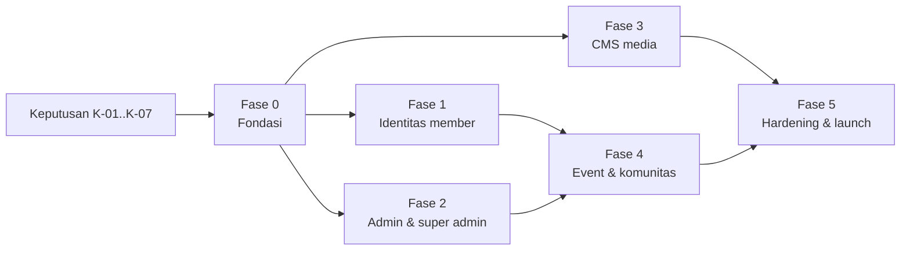

# USS Running — Rencana Deliverable sampai Go-Live

Status: **Disetujui pemilik, siap dieksekusi** · Tanggal: 2026-11-26 · Arsitektur: [ARCHITECTURE-TARGET.md](ARCHITECTURE-TARGET.md)

Dokumen ini adalah daftar kerja dari kondisi sekarang sampai situs live untuk publik, dipecah per fase, per lapisan (Backend, Frontend, Ops) dan lengkap dengan kriteria selesai. Dasarnya audit kode, konfigurasi Vercel dan situs live pada commit `9fe7ccb` (lihat [ARCHITECTURE-TARGET.md §2](ARCHITECTURE-TARGET.md#2-kondisi-saat-ini-snapshot-audit-2026-11-26)).

Kebutuhan wajib dari pemilik produk:

1. Website media + komunitas dengan **admin** dan **super admin**.
2. Setiap member **wajib** punya **ID + barcode** masing-masing.
3. Setiap member **wajib** punya **foto profil**.
4. **CMS konten media wajib** (Stories, gallery, media library, konten situs).

---

## 1. Definisi "live"

Situs dianggap live bila semua ini benar di domain produksi:

- Orang baru bisa daftar, menerima email verifikasi, mengaktifkan akun, mengunggah foto, dan mendapatkan kartu member dengan ID + barcode, tanpa bantuan admin, dari HP.
- Super admin bisa mengelola akun dan role tanpa SQL; admin bisa menjalankan konten dan event sehari-hari.
- Stories, gallery, partners dan home sepenuhnya diisi dari CMS, tanpa data dummy.
- Satu community run nyata sudah dijalankan lewat sistem: RSVP → email konfirmasi → event pass → check-in.
- Checklist go/no-go di §5 lulus.

---

## 2. Cara delivery

Keputusan pemilik (2026-11-26): **sampai go-live, semua pekerjaan dikirim langsung ke `main`**, tanpa branch baru, karena situs belum dipakai publik. Ini mengesampingkan anjuran branch terisolasi di [AGENTS.md §26](../AGENTS.md) untuk fase ini; AGENTS.md perlu diselaraskan (deliverable D0.9).

Gerbang wajib sebelum setiap push ke `main` tetap berlaku:

1. `git diff` dan `git status` direview; hanya file yang relevan ikut commit.
2. `npm run typecheck`, `npm run test:ci`, `npm run build` lulus. Untuk perubahan UI ditambah cek browser di 375px dan desktop.
3. Satu commit per unit kerja logis dengan pesan konvensional (`feat:`, `fix:`, `docs:`, `chore:`).
4. Setelah push: deployment Vercel READY pada SHA yang sama dan halaman terkait dicek.
5. **Migration database dan perubahan env produksi** selalu: backup/branch Neon dulu → `npm run db:migrate -- --status` → persetujuan eksplisit pemilik → apply → verifikasi. Tidak ada operasi destruktif tanpa persetujuan terpisah.
6. Jika `main` rusak: perbaiki maju atau `git revert`, tidak pernah force push.

Ukuran kerja: **S** ≈ setengah sampai satu hari, **M** ≈ dua sampai tiga hari, **L** ≈ satu minggu atau lebih (satu engineer + agent). Pemilik: **Owner** = pemilik produk/akun (DNS, kredensial, keputusan); **Eng** = engineering.

---

## 3. Ringkasan fase

| Fase | Tujuan | Selesai bila | Bergantung pada |
| --- | --- | --- | --- |
| 0 | Fondasi & konfigurasi | Akun nyata aktif lewat email; super admin masuk `/admin`; halaman publik tanpa "unavailable" | Keputusan K-01–K-07 |
| 1 | Identitas member | Member baru dapat kartu berfoto + ID + barcode sendiri dari HP | Fase 0 |
| 2 | Admin & super admin | Semua kelola akun/role/event tanpa SQL; email notifikasi terkirim otomatis | Fase 0 (paralel dengan Fase 3) |
| 3 | CMS media | Editor publish Story bergambar dan langsung tampil; share link punya preview | Fase 0 (paralel dengan Fase 2) |
| 4 | Event & komunitas | Satu community run nyata berjalan penuh lewat sistem | Fase 1 + Fase 2 |
| 5 | Hardening & launch | Checklist go/no-go lulus; rilis bertahap alpha → beta → publik | Fase 1–4 |



---

## 4. Deliverable per fase

### Fase 0 — Fondasi & konfigurasi

| ID | Lapisan | Deliverable | Kriteria selesai | Pemilik | Ukuran |
| --- | --- | --- | --- | --- | --- |
| D0.1 | Ops | Domain pengirim Resend terverifikasi; `RESEND_API_KEY`, `EMAIL_FROM_ADDRESS` di Vercel production + preview | Email verifikasi diterima di inbox (bukan spam) dari alamat no-reply USS; SPF/DKIM lulus | Owner | S |
| D0.2 | Ops / DB | Backup Neon, cek status migration, terapkan 010–019 | `db:migrate -- --status` = 19 applied / 0 pending; `/stories`, `/partners`, galeri home tidak lagi "temporarily unavailable" | Owner + Eng | S |
| D0.3 | Ops | Bucket object storage public + private dan env `AWS_*`, `MEDIA_*` | Cek storage di `prod:ready` lulus; satu upload uji dari admin berhasil dan tampil | Owner + Eng | S |
| D0.4 | Ops | `EVENT_PASS_TOKEN_KEYS` + `EVENT_PASS_TOKEN_KEY_ID`, `USS_SUPER_ADMIN_EMAIL` | `npm run prod:ready` lulus seluruhnya | Owner | S |
| D0.5 | BE | Script `npm run admin:bootstrap`: memberi role super_admin ke `USS_SUPER_ADMIN_EMAIL` | Hanya untuk akun aktif & terverifikasi; ditolak bila sudah ada super_admin aktif; idempoten; tercatat di audit log; ada test PGlite | Eng | S |
| D0.6 | BE / FE | Pensiunkan kode lama: `lib/session.ts`, `lib/admin.ts`, `app/admin/actions.ts`, `app/dashboard/actions.ts`, `components/admin/*`, `components/cms/Workspace.tsx`, `DemoProvider`, `PublicContent`; home & login membaca event dari service event baru; run dummy di `lib/content.ts` dihapus | Tidak ada lagi query ke `public.*` dari aplikasi; home, login dan `/runs` menampilkan event yang sama; test & build lulus. Drop tabel `public.*` menjadi migration terpisah dengan persetujuan | Eng | M |
| D0.7 | FE | Perbaikan cepat dari audit UI | Teks internal "The CMS controls…" hilang dari home; tahun "2,024" jadi "2024"; pengunjung tanpa sesi melihat "Sign in" (bukan "session expired") dan tanpa tombol Sign out; `/admin` tanpa sesi tetap memakai shell bermerek | Eng | S |
| D0.8 | DX | Lint jalan di Next 16 (ESLint flat config) dan masuk CI | `npm run lint` lulus di CI | Eng | S |
| D0.9 | Docs | Sinkronkan README, roadmap dan AGENTS.md §26 dengan keputusan delivery ke `main` | Tidak ada klaim README yang bertentangan dengan kode; roadmap mencatat BE-18, readiness gate, storage adapter, members directory | Eng | S |
| D0.10 | QA | Uji end-to-end signup dengan email nyata | Rekaman langkah: daftar → email → klik → login → dashboard aktif | Eng + Owner | S |

**Exit Fase 0:** satu akun member nyata aktif lewat email; satu super admin bisa membuka `/admin`; `prod:ready` lulus.

### Fase 1 — Identitas member (ID, barcode, foto wajib)

| ID | Lapisan | Deliverable | Kriteria selesai | Ukuran |
| --- | --- | --- | --- | --- |
| D1.1 | BE | Permission `media.upload.self` + action `uploadOwnAvatar` | Validasi MIME/ukuran/dimensi; resize 512×512; EXIF/GPS dibuang; disimpan di bucket private; URL bertanda tangan TTL pendek; rate limit; atomik dengan audit; test | M |
| D1.2 | BE / DB | Moderasi foto (sesuai K-01): kolom `avatar_status` dan metadata review, action approve/reject | Penolakan mewajibkan alasan dan mengembalikan member ke status profil belum lengkap; semua tercatat di audit | M |
| D1.3 | BE | Guard `requireCompleteMember()` + kebijakan data wajib (nama, HP, kontak darurat, foto) | Member card, RSVP dan event pass mengembalikan `PROFILE_INCOMPLETE` bila belum lengkap; test per jalur | S |
| D1.4 | BE / DB | Member ID manusiawi (K-02): `member_number` dari sequence, tampil `USS-000123` | Unik, immutable, backfill akun uji; DTO kartu & direktori memakai format baru; test | M |
| D1.5 | BE | Lookup member dari barcode untuk staff (`members.lookup`) | Mengembalikan foto, nama, Member ID, status saja; rate limit + audit; barcode tidak memberi akses apa pun | S |
| D1.6 | BE | Hak subjek data: export data sendiri (JSON) dan request hapus akun | Export hanya data milik sendiri; request hapus masuk antrian super admin; tercatat di audit | M |
| D1.7 | FE | Onboarding `/dashboard/onboarding`: foto → data wajib → kartu | Member aktif yang belum lengkap selalu diarahkan ke onboarding; progres tersimpan; bisa dilanjutkan | M |
| D1.8 | FE | Upload foto dengan crop 1:1, preview, kompresi di browser (≤ 900 KB) | Jalan di iOS Safari & Android Chrome, termasuk foto kamera langsung; state loading/error/retry jelas | M |
| D1.9 | FE | Member card v2: foto, nama, Member ID, status, QR dengan logo USS di tengah, unduh PNG | QR tetap terbaca oleh scanner aplikasi di HP nyata; tampilan rapi di 320–1440px | M |
| D1.10 | FE | Copy Join, Membership dan Privacy menjelaskan USS ID, barcode dan alasan foto wajib | Disetujui pemilik | S |
| D1.11 | FE | Layar "Scan member" di admin | Kamera + input manual; menampilkan hasil D1.5 | S |

**Exit Fase 1:** dari HP, orang baru bisa daftar sampai memegang kartu berfoto dengan ID + barcode tanpa bantuan admin.

### Fase 2 — Admin & super admin

| ID | Lapisan | Deliverable | Kriteria selesai | Ukuran |
| --- | --- | --- | --- | --- |
| D2.1 | FE | Modul Members: daftar + filter, detail, suspend / aktifkan / nonaktifkan dengan alasan | Memakai action BE-17 yang ada; konflik versi ditangani; tampil benar di mobile | M |
| D2.2 | FE | Modul Roles: beri/cabut admin & super_admin dengan alasan | Memakai `grantManagedRole`/`revokeManagedRole`; pesan jelas untuk "super admin terakhir" dan aksi ke diri sendiri | S |
| D2.3 | BE | Permission `members.read` untuk admin (K-03) dengan DTO terbatas | Admin tidak melihat kontak darurat/email lengkap; test izin | S |
| D2.4 | FE | Antrian moderasi foto | Approve/reject cepat dari HP; jumlah antrian tampil di overview | S |
| D2.5 | BE + FE | Peserta per event: daftar, filter status, batalkan, ekspor CSV | Ekspor terbatas & teraudit; memakai `getEventRegistrations`/`cancelEventRegistration` | M |
| D2.6 | BE | Job pengiriman notifikasi: route `/api/jobs/notifications` dilindungi secret + Vercel Schedules | Email konfirmasi/waitlist/batal RSVP terkirim otomatis ≤ 5 menit; retry terbatas; status gagal terlihat | M |
| D2.7 | FE | Antrian notifikasi di admin: lihat, kirim ulang, batalkan | Memakai action notifikasi yang ada | S |
| D2.8 | FE | Overview admin dengan angka nyata | Jumlah member per status, event mendatang, antrian moderasi, notifikasi gagal | S |
| D2.9 | FE | Modul Settings (minimal): template email, kontak & link sosial | Hanya `settings.manage`; perubahan teraudit; tidak ada rahasia di UI | M |
| D2.10 | FE | Scanner check-in dipindah ke dalam `/admin` (route lama redirect) | Navigasi admin konsisten; izin tetap `events.manage` | S |

**Exit Fase 2:** super admin mengelola semua akun & role tanpa SQL; email notifikasi terkirim otomatis.

### Fase 3 — CMS media (wajib)

| ID | Lapisan | Deliverable | Kriteria selesai | Ukuran |
| --- | --- | --- | --- | --- |
| D3.1 | BE | Upload media admin: presigned PUT ke object storage + finalisasi metadata di server | Mendukung file besar tanpa melewati batas body Vercel; validasi ulang di server; rate limit | M |
| D3.2 | FE | Modul Media library: grid, cari/filter, multi upload drag-drop, alt text wajib, arsip, info "dipakai di mana" | Dipakai oleh picker Stories, Gallery, Event, Partner, Site content | L |
| D3.3 | BE | Skema blok Story (`paragraph`, `heading`, `image`, `gallery`, `quote`, `embed` allowlist, `cta`, `divider`) + validasi + konversi body lama | Body tidak valid ditolak; render publik tanpa HTML mentah | M |
| D3.4 | FE | Editor Story berbasis blok + preview + publish/jadwal | Bisa dipakai dari laptop dan tablet; peringatan perubahan belum tersimpan | L |
| D3.5 | BE + FE | Kelola kategori, tag dan byline penulis | CRUD teraudit; tidak bisa hapus kategori yang masih dipakai | M |
| D3.6 | FE | Publik: daftar Stories (filter kategori), halaman artikel, `/gallery`, `/partners`, home dari CMS | Tidak ada data dummy di halaman publik; tampilan 320–1920px | L |
| D3.7 | FE | Paket SEO: metadata per halaman, OG image, `sitemap.ts`, `robots.ts`, favicon, 404 bermerek, redirect `/events` → `/runs` | Link Story yang dibagikan ke WhatsApp/IG menampilkan gambar & judul | M |
| D3.8 | BE | Revalidasi cache berbasis tag saat publish/unpublish | Konten tampil ≤ 1 menit tanpa redeploy | S |

**Exit Fase 3:** editor bisa menerbitkan Story bergambar yang langsung tampil, dan link-nya punya preview saat dibagikan.

### Fase 4 — Event & komunitas

| ID | Lapisan | Deliverable | Kriteria selesai | Ukuran |
| --- | --- | --- | --- | --- |
| D4.1 | BE | Event pass otomatis terbit saat registrasi terkonfirmasi + email berisi link pass (lewat D2.6) | Idempoten; pass berbeda dari barcode member | M |
| D4.2 | FE | Check-in menampilkan foto + nama member; fallback input manual | Crew bisa mencocokkan wajah; tidak ada data sensitif lain di layar | S |
| D4.3 | BE + FE | Riwayat & statistik member: event yang diikuti, kehadiran, streak | Registrasi dan kehadiran tetap dibedakan | M |
| D4.4 | Ops | Dry run: satu community run nyata dibuat dari CMS dan dijalankan bersama crew | Catatan temuan lapangan (scan di luar ruangan, sinyal, antrian) | S |
| D4.5 | BE + FE | (Opsional) Pengumuman ke member yang setuju dihubungi | Menghormati `marketing_consent`; bisa berhenti berlangganan | M |

**Exit Fase 4:** satu community run nyata berjalan penuh lewat sistem.

### Fase 5 — Hardening & launch

| ID | Lapisan | Deliverable | Kriteria selesai | Ukuran |
| --- | --- | --- | --- | --- |
| D5.1 | BE | Rate limit menyeluruh (signup, login, resend, upload, lookup) + proteksi bot di form publik | Test batas; tidak menghalangi user normal | M |
| D5.2 | Sec | Review keamanan & izin (OWASP, matriks permission, PII di log) | Tidak ada temuan kritis/tinggi terbuka | M |
| D5.3 | Ops | Log terstruktur, alert error, alert job notifikasi & upload gagal | Alert masuk ke kanal pemilik | S |
| D5.4 | QA | E2E Playwright di CI untuk alur kritis; audit aksesibilitas; uji perangkat iOS/Android; uji scan QR di luar ruangan | Semua lulus; temuan P0/P1 tertutup | L |
| D5.5 | Perf | Query plan untuk daftar besar; Lighthouse halaman publik; ukuran gambar | Halaman publik utama cepat di 4G | M |
| D5.6 | Legal | Privacy Policy (foto, UU PDP, retensi), Terms, cookie | Disetujui pemilik / penasihat hukum | S |
| D5.7 | Ops | Staging (branch Neon + env preview), latihan migration & rollback, uji restore backup, runbook insiden | Restore pernah berhasil diuji | M |
| D5.8 | Ops | Domain `ussrunning.com`, DNS, SPF/DKIM/DMARC, `APP_BASE_URL` final | Email & situs memakai domain resmi | S |
| D5.9 | Ops | Pindah kepemilikan GitHub/Vercel/Neon/Resend ke akun USS ([USS-OWNERSHIP-MIGRATION-PLAN.md](USS-OWNERSHIP-MIGRATION-PLAN.md)) | Setiap langkah punya bukti & jalur rollback | M |
| D5.10 | Policy | Keluar dari mode early development: AGENTS.md beralih ke `feature → preview → review → main` | Disetujui pemilik sebelum beta | S |
| D5.11 | Launch | Alpha crew inti (10–20 orang) → beta tertutup → publik | Go/no-go §5 lulus di tiap tahap | — |

---

## 5. Checklist go/no-go

- [ ] `npm run prod:ready` lulus di production.
- [ ] Semua migration diterapkan; backup terakhir < 24 jam dan restore pernah diuji.
- [ ] Signup → verifikasi → onboarding → kartu berfoto lulus di iOS & Android.
- [ ] Super admin dan minimal dua admin aktif; tidak ada akses lewat SQL manual yang dibutuhkan.
- [ ] Email transaksional terkirim dari domain resmi, tidak masuk spam.
- [ ] Halaman publik tanpa data dummy dan tanpa pesan "unavailable".
- [ ] E2E kritis hijau di CI; tidak ada temuan keamanan kritis/tinggi.
- [ ] Privacy Policy & Terms terbaru tayang.
- [ ] Alert aktif dan runbook insiden ada.
- [ ] AGENTS.md sudah keluar dari mode early development.

---

## 6. Risiko & mitigasi

| Risiko | Dampak | Mitigasi |
| --- | --- | --- |
| Migration 010–019 gagal di Neon | Fitur CMS/event tidak jalan | Backup/branch dulu, `--status`, rehearsal di branch Neon, runner sudah transaksional |
| Email masuk spam | Member tidak bisa aktif | Domain terverifikasi, SPF/DKIM/DMARC, uji ke Gmail/Outlook/Yahoo |
| Upload gagal di HP (ukuran/format HEIC) | Onboarding macet | Kompresi & konversi di browser, pesan error jelas, uji perangkat nyata |
| Foto profil = data pribadi sensitif | Risiko hukum UU PDP | Bucket private, URL bertanda tangan, persetujuan eksplisit, retensi & hapus |
| Delivery langsung ke `main` | Regressi tampil di situs | Gerbang §2 wajib; revert cepat; staging disiapkan sebelum beta |
| Super admin tunggal hilang akses | Admin terkunci | Minimal dua super admin; script bootstrap terdokumentasi |
| Scan QR gagal di lapangan | Antrian check-in | Uji outdoor, fallback input manual, kecerahan layar |

---

## 7. Pemetaan ke roadmap lama

| Roadmap lama | Di rencana ini |
| --- | --- |
| BE-18 Role & Permission Administration | Backend sudah ada (`a55dcba`); UI = D2.2 |
| BE-19 Search / Filter / Pagination Hardening | D5.5 |
| BE-20 Security / Rate Limiting Hardening | D5.1, D5.2 |
| BE-21 Observability | D5.3 |
| BE-22 Staging / Production Readiness | D0.1–D0.4, D5.7, D5.8 |
| FE-15 Users / Roles Administration UI | D2.1, D2.2 |
| FE-16 Audit / Revision Workspace | Tetap backlog pasca go-live (fondasi read-only sudah ada) |
| FE-17 Member Registration History | D4.3 |
| FE-18 Responsive CMS Hardening | Bagian dari setiap deliverable FE + D5.4 |
| FE-19 Accessibility Hardening | D5.4 |
| FE-20 Visual Regression / Production QA | D5.4 |
| OPS-OWNERSHIP-MIGRATION | D5.9 |

---

## 8. Keputusan

Lihat [ARCHITECTURE-TARGET.md §11](ARCHITECTURE-TARGET.md#11-keputusan-arsitektur). Ringkas:

| ID | Keputusan | Rekomendasi | Status |
| --- | --- | --- | --- |
| K-01 | Aturan & moderasi foto profil | Wajib sebelum kartu/RSVP; auto-approve, admin bisa menolak | **Diputuskan 2026-11-26 (rekomendasi)** |
| K-02 | Format Member ID | `USS-000123` dari sequence | **Diputuskan 2026-11-26 (rekomendasi)** |
| K-03 | Admin melihat daftar member | Ya, read-only terbatas | **Diputuskan 2026-11-26 (rekomendasi)** |
| K-04 | Bahasa situs | Publik Inggris, bantuan CMS Indonesia, i18n pasca go-live | **Diputuskan 2026-11-26 (rekomendasi)** |
| K-05 | Data & tabel lama `public.*` | Dipensiunkan | **Diputuskan 2026-11-26 (rekomendasi)** |
| K-06 | Metode verifikasi email | Link USS via Resend saja | **Diputuskan 2026-11-26 (rekomendasi)** |
| K-07 | Alur delivery | Langsung ke `main` sampai go-live | **Diputuskan 2026-11-26** |

---

## 9. Eksekusi paralel & cara melanjutkan

Eksekusi dibagi ke beberapa jalur kerja (agent) yang berjalan paralel di salinan kerja lokal terpisah. Agent lead meninjau setiap hasil, menggabungkannya ke `main` lokal, menjalankan gerbang §2 pada hasil gabungan, lalu push `main` dan memverifikasi deployment Vercel. Tidak ada branch yang di-push ke origin (K-07).

| Jalur | Cakupan | Deliverable | Area file utama |
| --- | --- | --- | --- |
| Identitas member | Foto wajib, Member ID, onboarding, kartu v2, lookup barcode, bootstrap super admin | D0.5, D1.1–D1.11 | `lib/member`, `lib/media`, `lib/authz`, `features/member-card`, `features/member-dashboard`, `app/dashboard`, `scripts/admin`, migration baru |
| Admin UI | Members, Roles, Overview, scanner di `/admin` | D2.1–D2.4, D2.8, D2.10 | `features/members-cms`, `features/cms`, `app/admin` |
| Notifikasi & event ops | Job email terjadwal, peserta per event + CSV, antrian notifikasi, pass otomatis | D2.5–D2.7, D4.1 | `lib/notifications`, `lib/registrations`, `app/api/jobs`, konfigurasi schedule |
| CMS media | Media library, upload admin, Story berbasis blok, kategori/tag, revalidasi cache | D3.1–D3.5, D3.8 | `lib/media`, `lib/stories`, `features/media`, `features/stories-cms` |
| Public & SEO | Pensiun kode lama/dummy, perbaikan UI cepat, halaman publik dari CMS, paket SEO | D0.6, D0.7, D3.6, D3.7 | `app/(public pages)`, `components/*`, `lib/content.ts` |
| Lead | Koordinasi, review, integrasi, AGENTS/roadmap, verifikasi deploy | D0.9, integrasi | dokumen, `AGENTS.md` |
| Owner | Resend & DNS, bucket storage, env key, persetujuan migration | D0.1–D0.4 | Vercel, Neon, Resend, DNS |

File yang disentuh lebih dari satu jalur (`app/admin/page.tsx`, `features/cms/navigation.ts`, `lib/authz/permissions.ts`, nomor migration baru) diintegrasikan oleh lead; setiap jalur mengambil nomor migration berikutnya hanya setelah lead mengalokasikannya (urutan: Identitas member mulai `020`).

**Prasyarat eksekusi:** lingkungan kerja harus bisa menjalankan `npm ci`. Pada 2026-11-26 sesi kerja awal tidak memiliki akses network untuk install package, sehingga eksekusi kode menunggu akses tersebut aktif.

**Prompt untuk melanjutkan di sesi baru:**

```text
Baca AGENTS.md, docs/GO-LIVE-DELIVERY-PLAN.md dan docs/ARCHITECTURE-TARGET.md.
Jalankan rencana go-live mulai Fase 0 dengan pembagian jalur di §9, memakai keputusan K-01..K-07 yang sudah diputuskan.
Kirim langsung ke main setelah gerbang §2 lulus; jangan push branch.
```
