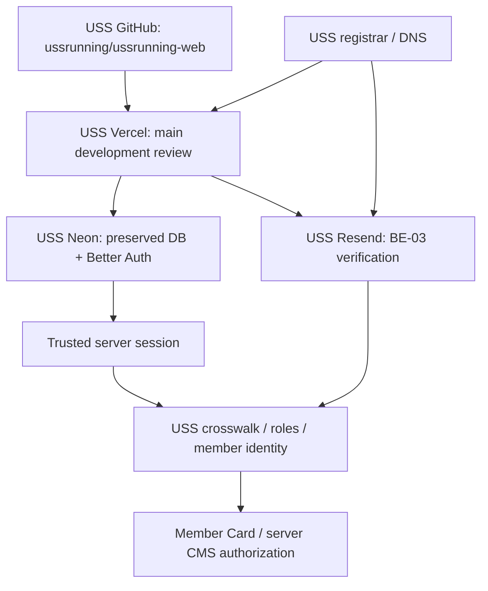

# USS Running Ownership Migration Plan

## 1. Scope and evidence

Audit: 2026-10-09 (Asia/Jakarta). Read [AGENTS.md](../AGENTS.md) and [ENGINEERING-ROADMAP.md](ENGINEERING-ROADMAP.md). This is an **AUDIT + EXECUTION PLAN**. Early-development document delivery does not authorize infrastructure migration. No transfer, key creation/rotation/revocation, integration disconnect, auth disablement, DB migration/deletion, DNS write or account creation occurred. DB reads used metadata and aggregate SELECTs only; no user/session/key values. Vercel env values stayed masked.

Source checkout: dirty `feature/member-dashboard-foundation`, HEAD `d28ab503613fcd71c2e259d05530306d84c9b39f`; unrelated FE-06 work excluded. Isolated audit branch `codex/ownership-migration-audit` starts at remote main `fb7fb116c7899a2ac663067dec6e151ee1b52217`. Refresh every checkpoint before execution. OBSERVED means current API/browser/source evidence; HISTORICAL means prior committed evidence; UNKNOWN/BLOCKED means not verified; PROPOSED means future action. No migration phase is DONE or rollback-ready.

## 2. Ownership map

| Platform | Observed current owner/resource | Target | Missing evidence |
| --- | --- | --- | --- |
| GitHub | Private repository: `ardidwi/ussrunning-web`, ID `1399461644`, owner type User, default main; connector admin/maintain/push true | `ussrunning/ussrunning-web`, transfer existing repo | Target repo GET and public org GET returned 404. Org existence, name availability, incoming/create-repo permission and target App grants unverified; 404 is not proof of availability. |
| Vercel | ElevationJunkies / elevation-junkies, Hobby, `team_oKmfAHx4jCV7VNiWP1Y0Zpfl`; ussrunning-web `prj_XIpmIYddhP242c7WQrxO8dwatZCq` | User supplied `https://vercel.com/ussrunning` | Connector target-scope error identifies `team_PfOErV9jQYpJBlxQlpXGDfwn` but denies access (403); browser returns 404 for current signed-in account. Target role/billing not verified. |
| Neon | neon-aqua-battery `lingering-lab-29979216`; Vercel: ElevationJunkies `org-hidden-base-80801614`, managed_by vercel | Dedicated USS org/native integration, exact target ID TBD | Managed transfer eligibility, target org, provider continuity and recovery |
| Resend | BE-03 source implementation exists; current team/account/sender/key names UNKNOWN; supplied profile URL opens login | Dedicated USS team and least-privilege dedicated sending key | No Resend connector/session; no mail bindings in Vercel inventory |
| DNS | Registrar/zone owner UNKNOWN; source contact hello@ussrunning.com; Vercel lists only vercel.app alias | USS registrar/DNS billing and recovery | Authoritative zone export, domain ownership and sender records |

Use named USS administrators, MFA, organization billing/recovery and scoped service access. No account/permission was created. Other visible Neon organization ardi (`org-quiet-pine-74012635`) contains unrelated projects; none are migration targets.



## 3. GitHub discovery and transfer decision

Main SHA `fb7fb116c7899a2ac663067dec6e151ee1b52217`; main metadata reports protected=false, protection disabled, required checks off. Rulesets GET returned 403 requiring paid plan or public repo. Do not change visibility to bypass this. No local tags and no GitHub releases observed.

| Important remote branch | Observed SHA |
| --- | --- |
| main / feature/event-domain-foundation | fb7fb116c7899a2ac663067dec6e151ee1b52217 |
| integration/member-foundation-main | d28ab503613fcd71c2e259d05530306d84c9b39f |
| integration/member-foundation-release | 8914f1370814b5b4a1707e17eacfbcc00fe681e2 |
| integration/fe04-fe05-delivery | 0368877866b2a89fb7e9d8c4714857f1e44b8be0 |
| integration/pre-fe04-baseline | ffccaa0a75edce41595d8a8d376659d655b8de3f |
| feature/member-card-rbac-frontend | 8961f0d187806adcde2e5a3aabd76b9771f181c3 |
| feature/db-foundation | 9dfbbf1b623a2e15305e5ad6283ff0bd4bc48379 |
| feature/auth-account-provisioning | e799fdde35f9519d5327488a5821b102933e29a2 |
| feature/email-verification | 5b9ea388fdb55696121eaba493c99195fe15138c |
| feature/frontend-form-system | a40db36f4a03f3c54303306bd133d51d85992e35 |
| feature/frontend-auth-flows | f7038c3c57530056cb17286b60e2f955ea07a0ef |

Other remote branches: backend-v1, feature/business-rules-v2, feature/home-motion-experience, feature/product-architecture-docs, feature/rsvp-capacity-hardening, feature/scroll-preview, feature/ui-motion-experience, chore/early-development-delivery. Local active worktrees include member-dashboard-foundation, neon-auth-wiring, backend-member-rsvp-hardening and event-domain-foundation. Preserve all refs and unpushed work; coordinate a narrow delivery freeze before execution.

Only tracked Actions workflow: `.github/workflows/ci.yml`, push main / pull_request, Ubuntu, checkout@v4, setup-node@v4 Node 22, npm install, npm run build. No explicit secrets/vars references. This does not prove repository/org/environment secrets absent: names/scopes, deploy keys, webhooks and GitHub App installation inventory are inaccessible through available connector. Vercel browser confirms linked ardidwi repo and main branch; main Vercel check succeeds. No custom Actions Vercel pipeline present.

**Decision: TRANSFER**, not manual copy. GitHub supports ownership transfer preserving history and attached repository resources; source admin, target create-repo permission and nonconflicting name/fork network are required. Secrets/webhooks/deploy keys remain attached but org policies/App grants need checking. Update local remotes explicitly despite redirects. [GitHub transfer docs](https://docs.github.com/en/repositories/creating-and-managing-repositories/transferring-a-repository).

Before transfer verify authenticated target org exists, name available including private repos/fork network, create/incoming-transfer policy, current admin and target Vercel App grants, collaborators/Actions scope and backup restore. After separately authorized transfer verify same repository ID/refs/private visibility/default main, Actions and Vercel access. Expected remote: `https://github.com/ussrunning/ussrunning-web`; future command `git remote set-url origin https://github.com/ussrunning/ussrunning-web` for each clone (worktrees share repository config). Do not create a repo at old path; redirects can be lost. Transfer-back is conditional on policy/permissions and old-name restrictions, not guaranteed.

## 4. Vercel discovery and transfer decision

Connector list confirms project/team IDs. Details/env/domains returned 404, deployments 403. Authenticated browser resolved source inventory without editing settings.

| Setting | OBSERVED |
| --- | --- |
| Git / production branch | ardidwi/ussrunning-web (login ardidwi) / main |
| Deployment | READY, fb7fb116c7899a2ac663067dec6e151ee1b52217, dashboard ID FKDLRSRLzEpD66h5v6jaDSG8weZX |
| Production alias | https://ussrunning-web-seven.vercel.app; sole project domain, Valid Configuration / Production |
| Deployment hostname | ussrunning-r0aqf2x2k-elevation-junkies.vercel.app |
| Framework / Node | Next.js / 24.x; CI uses Node 22 (difference preserved, not silently changed) |
| Root | Blank = repository root; include outside-root files enabled |
| Commands | Build/install/output/dev overrides disabled; framework defaults; package scripts build=next build, dev=next dev |
| Build | Ignored step Automatic; Basic machine; on-demand concurrency disabled |
| Checks / rolling release | No deployment checks / disabled |
| Protection | Vercel Authentication enabled, Standard Protection; password/IP off; protected sourcemaps on; no automation bypass secret listed |
| Native integration | Neon, Billed Via Vercel; installation icfg_S2Uu0Ep967IUX1OzzykgITeI; resource store_ZqVIZRXK5ey7H0yV, neon-aqua-battery; one installed product shown connected to ussrunning-web |

### Masked environment inventory

20 unique names / 21 project bindings; Shared tab says **No shared variables linked**. No Development binding observed. Values were not revealed.

| Category | Names | Targets |
| --- | --- | --- |
| Database | DATABASE_URL, DATABASE_URL_UNPOOLED, POSTGRES_PRISMA_URL, POSTGRES_USER, PGPASSWORD, PGDATABASE, POSTGRES_URL, POSTGRES_URL_NO_SSL, POSTGRES_HOST, POSTGRES_PASSWORD, POSTGRES_URL_NON_POOLING, PGHOST, PGHOST_UNPOOLED, POSTGRES_DATABASE, PGUSER | Production + Preview, integration-managed |
| Auth | NEON_AUTH_BASE_URL, VITE_NEON_AUTH_URL | Production + Preview, integration-managed; VITE name unused by this Next app |
| Session | NEON_AUTH_COOKIE_SECRET | Separate Production and Preview bindings |
| CI/integration metadata | NEON_PROJECT_ID | Production + Preview |
| App URL | APP_BASE_URL | Production only |
| Email | RESEND_API_KEY, EMAIL_FROM_ADDRESS, EMAIL_FROM_NAME | Not observed |
| Callbacks | No dedicated variable observed | Provider configuration separate |
| Monitoring/other | No custom variable observed | System environment access enabled; generated vars not enumerated |

USS_SUPER_ADMIN_EMAIL, optional USS policy/limits and EMAIL TTL/rate/timeout variables are supported in source but not observed. Never retrieve decrypted values to fill inventory. Secure owner-managed secret recovery outside Git is required before disconnect; names alone cannot restore service.

Prefer existing project transfer after source Owner/target member/billing are proven; recreation only if transfer ineligible or cannot preserve behavior. Project transfer carries deployments/settings/env/domains/Git link; native integrations are separate. [Vercel project transfer](https://vercel.com/docs/projects/transferring-projects).

**Ordering constraint:** keep Neon in Phase 4. Phase 2 must prove an authorized bridge to unchanged old DB/Auth including isolated Preview bindings and secure env restoration; otherwise BLOCK. Do not transfer/disconnect the native Neon installation implicitly during Vercel migration.

Native integration transfer requires source projects disconnected; disconnect removes their integration env bindings and new builds can fail until reconnect. Confirm provider/feature eligibility. [Integration transfer](https://vercel.com/docs/integrations/install-an-integration/transferring-an-integration). Separate resource transfer is documented **not reversible**; require operational recovery, never promise transfer-back. [Resource transfer](https://vercel.com/docs/integrations/install-an-integration/product-integration#transfer-a-resource-to-another-team).

## 5. Resend / provider mail distinction

Contracts: lib/email/config.ts, providers/resend.ts, service.ts, lib/auth/email-verification.ts, verification-actions.ts, lib/email/proof.ts, [EMAIL-VERIFICATION.md](EMAIL-VERIFICATION.md). Resend SDK 6.13.0.

Required BE-03 names: RESEND_API_KEY, EMAIL_FROM_ADDRESS, APP_BASE_URL. EMAIL_FROM_NAME defaults USS Running. Exact From: `EMAIL_FROM_NAME <EMAIL_FROM_ADDRESS>`. No fixed sender address/domain in code; neither notify.ussrunning.com nor apex use is confirmed. Optional names/defaults: EMAIL_VERIFICATION_TTL_MINUTES=30, EMAIL_VERIFICATION_RESEND_COOLDOWN_SECONDS=60, EMAIL_VERIFICATION_RATE_WINDOW_SECONDS=3600, EMAIL_VERIFICATION_MAX_REQUESTS=5, EMAIL_PROVIDER_TIMEOUT_MS=15000.

A. **BE-03 Resend:** own-account request/resend, database-issued hashed proof/rate rules; delivery outside transaction, idempotency and uss.notification_deliveries; `APP_BASE_URL/api/account/verify-email#token=...`, one-time consumption activates USS account. Keep link tracking disabled. No email sent here.

B. **Neon Better Auth shared mail/OTP:** provider credentials/session/OTP/recovery; OBSERVED shared sender auth@mail.myneon.app, name Neon Auth. Not BE-03 sender/key or USS verification authority. Live config: email/password enabled, signup allowed, verification on signup/signin false, require verification false, method otp, auto-sign-in after verification true; shared Google OAuth. Preserve during ownership change; policy change is separate scope.

Recommend dedicated USS Resend team and scoped key; notify.ussrunning.com is a proposed transactional subdomain, pending owner/zone and verified sender inventory. Profile URL opens login; team, sender verification, API key NAMES/scopes, activity/webhooks unknown. Resend domain claim can move domain between teams; recent activity may require support release and old sender recovery can be affected. [Resend domain claim](https://resend.com/changelog/domain-claim). Do not create/rotate keys or claim domain in audit.

## 6. Neon discovery and transfer vs recreate

Vercel browser maps neon-aqua-battery to this project; Neon branch previews match repo branches. Resource ID is not Neon project ID. Exact secret binding-to-endpoint equality was not read and remains preflight.

OBSERVED lingering-lab-29979216, PostgreSQL 17, aws-us-east-1, org-hidden-base-80801614, history retention 21600 seconds (6h). Default main br-autumn-glitter-auh7rine ready/unprotected; DB neondb, owner neondb_owner. Direct default host ep-still-river-au4rkcdl.c-10.us-east-1.aws.neon.tech; pooled host inserts -pooler. Nine read_write computes idle at inventory, 0.25 CU bounds; idle is not a failure.

| Branch | ID | Compute ID |
| --- | --- | --- |
| main default | br-autumn-glitter-auh7rine | ep-still-river-au4rkcdl |
| backend-v1 | br-curly-block-auioo7ws | ep-little-fog-auc6gfgq |
| validation/uss-auth-wiring-20261009 | br-curly-haze-aulltpz3 | ep-proud-tree-au2itkm3 |
| preview/feature/event-domain-foundation | br-proud-moon-aunrdwz2 | ep-long-firefly-auxr7jm6 |
| preview/integration/member-foundation-release | br-long-darkness-aumys6de | ep-floral-lake-au7pezxy |
| preview/integration/member-foundation-main | br-rough-unit-au2hfx5i | ep-red-heart-au1jz2qo |
| preview/integration/fe04-fe05-delivery | br-damp-meadow-aucpinnq | ep-empty-tree-auj50wq8 |
| preview/chore/early-development-delivery | br-sweet-flower-audtv7l7 | ep-divine-dream-au1dfeyu |
| preview/integration/pre-fe04-baseline | br-patient-union-aug4n4l8 | ep-fragrant-wildflower-auluroxk |

Previews creation_source=vercel; main/backend-v1/validation console. No branch declared disposable/deleted. Auth: better_auth, owned_by neon, provider project ID 1448d4c3-ce2d-48e4-9522-36daf931fff0. Base URL https://ep-still-river-au4rkcdl.neonauth.c-10.us-east-1.aws.neon.tech/neondb/auth; JWKS appends /.well-known/jwks.json. Configuration observed, actual auth not exercised.

Live inventory: **53 tables** (neon_auth 9, public 14, uss 29, uss_migrations 1). Relevant: neon_auth.user/account/session/verification/jwks/organization/member/invitation/project_config; public.user_profiles/legal_consents/admin_activity and legacy CMS/event/media; uss.accounts/member_profiles/roles/account_roles/email_verification_tokens/audit_logs and event/site_content/partner/story revision tables. Permissions are server policy lib/authz/permissions.ts, not a live permissions table. Member ID/barcode columns on uss.accounts are distinct from event_passes.

| Aggregate | Rows |
| --- | --- |
| neon_auth.user | 0 |
| uss.accounts | 0 |
| uss.member_profiles | 0 |
| uss.roles | 3 |
| uss.account_roles | 0 |
| uss.audit_logs | 0 |
| public.user_profiles | 0 |
| uss_migrations.schema_migrations | 9 |

Ledger read: 001–009, filenames/checksums available. All nine filenames and canonical checksums match the live ledger using the repository loader (CRLF normalized to LF). Raw Windows byte hashes differ as expected. Recheck at cutover; deployment grant equality remains unverified. Legacy/public and managed neon_auth schema are not reconstructed by those nine USS migration files. Empty aggregate counts do not permit reset; refresh all branch counts/digests before cutover.

**OPTION A — existing project transfer:** preferred conditional path. Generic Neon org transfer supports personal API key with source admin/target member; available MCP has no transfer action. Vercel-managed resource requires provider/Marketplace eligibility, Auth/endpoint and billing continuity, target org and proven recovery; do not guess PATCH semantics. [Neon org transfer requirements](https://neon.com/docs/manage/orgs-api).

**OPTION B — new USS project:** fallback only after A confirmed impossible/unsafe. Replay versioned USS migrations in isolated test project; reconcile public legacy schema, functions/extensions/constraints/grants/ledger. Consistent encrypted schema/data restore preserves IDs, timestamps, all FK/grants/history/deliveries, UUID/member_id/barcode_value. Never replay signup/provisioning to regenerate identities. Managed provider passwords/user IDs/JWKS/sessions require vendor-supported export/import; SQL copying neon_auth is not assumed supported. New issuer/cookie/host can invalidate sessions: plan deliberate re-login and approved immutable crosswalk continuity. Block if Auth identity cannot be preserved. Compare full counts/relations/identity digests and rehearse restore before cutover. Keep original project unchanged; restore old bindings only after reconciling any new writes.

## 7. Domain / identity dependency audit

Only current Vercel domain: ussrunning-web-seven.vercel.app. ussrunning.com/www/notify not mapped. Default resolver returned name-not-exist for A/AAAA/CNAME/MX/TXT/NS on these hosts; explicit public resolver denied and HTTPS resolver timed out. This is local evidence, not definitive global DNS/registration availability. Registrar/zone owner, actual SPF/DKIM/DMARC and selectors UNKNOWN.

Preserve authoritative A/AAAA/CNAME, MX mail/return-path, TXT verifications, single SPF policy per hostname, exact DKIM selectors, DMARC/root-subdomain policy, NS/SOA/TTLs/DNSSEC/DS and CAA if present. Export complete zone, not just public queries. Email DNS readiness is Phase 3 dependency even though web cutover is Phase 6. Never invent provider record values or alter DNS here.

Neon trusted origins: 19 exact HTTPS Vercel URLs, allow_localhost=true; no ussrunning.com/www/notify. Stable: ussrunning-web-seven.vercel.app, ussrunning-web-elevation-junkies.vercel.app, ussrunning-web-git-main-elevation-junkies.vercel.app. Also feature-scroll-preview and feature-home-motion-54a0f0 branch hosts. Deployment prefixes under elevation-junkies.vercel.app: ussrunning-c648jr6az, ke0edy2sv, 3fi95jtni, n7vb6om74, 6aa4zsuy8, 3z6hmpo7e, 2av4xeua6, 9wio4062s, jgzuiq0nv, qwp3yn4x8, ird2a4d8r, geb5eskur, 43vphc8ni, r0aqf2x2k (each has ussrunning- prefix). Full exact list must be exported before mutation; only explicit approved new origins, no broad wildcard; retain old recovery origins until window ends.

```text
Browser -> /api/auth/[...path] -> Managed Neon Better Auth
 -> trusted server getSession -> whitelist identity (discard role metadata)
 -> immutable uss.accounts.auth_provider_user_id crosswalk
 -> verified active account -> DB account_roles + server permission registry
 -> owner-only Member Card -> guarded CMS/history services
```

Legacy lib/session.ts also uses provider role/USS_SUPER_ADMIN_EMAIL and public.user_profiles. Validate its consumers separately from USS RBAC, never promote arbitrary provider/client role claims. Account provisioning may write on trusted access; no such access was invoked in audit. FE-02 main still connects login only; non-login operations return AUTH_UNAVAILABLE. Profile adapter and live roles/provider checks remain open, requiring separate approved implementation before full acceptance.

| Dependency | Ownership binding / preservation |
| --- | --- |
| Repo owner/name/ID | GitHub + Vercel App; preserve refs, update remotes/grants |
| DATABASE_URL/unpooled/PG bindings | Neon project/branch/endpoint/DB/role + native integration; exact environment isolation and same rows/grants |
| Auth base URL/JWKS/provider ID | Neon branch/issuer; subject/session validation continuity |
| Cookie secret | Vercel environment/provider proxy; preserve securely, no implicit rotation; host scope/re-login check |
| Origins/OAuth callbacks | Provider + app domains; exact hosts and safe redirects |
| APP_BASE_URL | Trusted app origin; BE-03 links never trust request Host |
| Resend key/From | Resend team + verified sender DNS; delivery/link/authentication checks |
| UUID/provider ID/member ID/barcode | Immutable persistent crosswalk; no duplicates/regeneration; barcode != event pass |
| Roles/audit/revisions | DB grants/history + typed policy; no lost grants/escalation/history |

## 8. Backup / recovery requirements

None of these backups or restore rehearsals were executed in this audit. Sensitive exports belong in encrypted owner-controlled storage outside Git.

| Platform | Required artifacts and tests |
| --- | --- |
| GitHub | Full mirror clone + bundle of all refs; branches/tags/main SHA manifest; bundle verification/checkout recovery; LFS if any; unpushed commits separately; settings/Apps/hooks/collaborators and secret NAMES/scopes export |
| Vercel | Config/team/project IDs, Git/branch, build/runtime/protection/region/cron, domain mapping, env names/targets/branch overrides, known-good READY SHA/URL and integration IDs; secure owner-managed secret recovery and trial rebuild (names alone insufficient) |
| Neon | Separately authorized preserved recovery branch/snapshot and retention longer than window; encrypted consistent direct-connection logical schema/data backup; grants/functions/extensions/ledger, critical identity counts/digests, managed Auth backup/restore support; isolated restore rehearsal |
| Resend | Team/owner, verified domain/status, sender addresses, API key NAMES/scopes only, tracking/webhooks/activity; secure old config recovery and domain-claim/support reversal strategy |
| DNS | Full authoritative zone export/screenshots incl TTL, NS/DNSSEC/DS, A/AAAA/CNAME/MX/TXT/SPF/DKIM/DMARC/CAA; registrar ownership/recovery and proven restoration access |

Proposed rollback window: at least 7 days, approved and staffed before execution. Observed six-hour Neon retention is insufficient; extend authorized recovery retention first, not during audit.

## 9. Phased execution plan

Execution statuses: NOT_STARTED, IN_PROGRESS, DONE, VERIFIED, ROLLBACK_READY, BLOCKED. Before advancement each phase needs three independent evidence flags **DONE + VERIFIED + ROLLBACK_READY**, with operator, timestamp, exact IDs/SHAs, check results and recovery artifact/rehearsal. Current flags for every phase: DONE=no, VERIFIED=no, ROLLBACK_READY=no. Metadata success or a written plan sets none of these flags. Explicit scope authorization is needed for future infrastructure mutations. Phase 0 inventory remains incomplete; Phase 1 cannot start yet.

### PHASE 0 — INVENTORY / BACKUP

- Status IN_PROGRESS; risk LOW for metadata, MEDIUM for backup/PII; downtime none expected for audit, backup load measured.
- Objective: complete inventory and prove restoration. Current owner: ardidwi (login ardidwi), ElevationJunkies/managed Neon, unknown mail/DNS; target: USS custodians.
- Resources: all platform IDs/settings/refs in sections 2–7 and backup artifacts section 8.
- Preconditions: missing source/target metadata access, encrypted backup location, Resend/registrar owner response, agreed narrow delivery freeze.
- Actions: close evidence gaps, inventory App/secret names/targets and exact target permissions, export settings/refs; separately authorize DB recovery creation and restore rehearsal; set measured abort/downtime thresholds.
- Verify: inventory complete, backups accessible, mirror/DB/Auth restore works, identity/ledger equality, no unrelated workload in transfer scope.
- Rollback: no cutover occurred; retain current resources. Incomplete recovery blocks every later phase.

### PHASE 1 — GITHUB

- Status BLOCKED (target org/name/permissions/App grants); risk MEDIUM; expected serving downtime none if old deployment remains, new-build/CI interruption possible.
- Objective: transfer existing repo with history intact. Current owner ardidwi (ardidwi); target ussrunning org.
- Resources: repo 1399461644, ardidwi/ussrunning-web -> ussrunning/ussrunning-web, all refs/settings/CI/Apps/hooks.
- Preconditions: Phase 0 three gates, target create/incoming permission and name/fork availability, source admin, target Vercel App access, explicit transfer authorization.
- Actions: narrow push freeze, refresh manifest/main, supported transfer, update clone remotes, verify collaborators/Actions, reconnect Vercel Git path only within authorized scope.
- Verify: same repo ID/SHAs/refs/private/default main; safe fetch/push, CI and old Vercel build from new USS repo; old deployment serves while resolving access.
- Rollback: fix target App/Git link forward; restore original remote if transfer never completed; transfer-back only when permissions/policy/name support proven. Mirror recovers code, not integrations; old-path recreation may break redirect.

### PHASE 2 — VERCEL

- Status BLOCKED (target access and unchanged-Neon bridge); risk HIGH; no serving downtime only if bridge proven, otherwise stop rather than claim zero.
- Objective: USS-owned app project, Neon ownership unchanged until Phase 4. Current ElevationJunkies; target ussrunning candidate team_PfOErV9jQYpJBlxQlpXGDfwn (verify authenticated settings).
- Resources: prj_XIpmIYddhP242c7WQrxO8dwatZCq, Git/build/protection/env/domains; icfg_S2Uu0Ep967IUX1OzzykgITeI / store_ZqVIZRXK5ey7H0yV dependency.
- Preconditions: Phase 1 gates, source Owner/target member/billing, secure env recovery, tested unchanged-old-Neon bridge with preview isolation, explicit scope; no implicit native resource transfer/disconnect.
- Actions: review transfer manifest, prefer project transfer, reconnect USS Git App and authorized secure env bindings; deploy exact known-good commit. Recreate only if transfer confirmed unsuitable.
- Verify: ownership and USS repo, READY SHA, settings/protection/domains preserved, desktop/mobile core pages and unchanged DB/provider/preview behavior.
- Rollback: preserve last READY deployment; conditional transfer-back/reconnect or config-restored recovery project; securely restore known-good Git/env/domain bindings. No history rewrite.

### PHASE 3 — RESEND

- Status BLOCKED (source team/sender/DNS and connected verification flow); risk HIGH; app pages stay serving, email interruption possible during domain claim/DNS propagation, duration TBD.
- Objective: USS BE-03 transactional mail ownership. Current unknown; target dedicated USS Resend team ID TBD.
- Resources: sender domain (notify.ussrunning.com PROPOSED), From, dedicated key names/scopes, EMAIL/RESEND/APP_BASE_URL bindings and DNS sending records.
- Preconditions: Phase 2 gates, source mail/registrar access, secure old config recovery, domain-claim impact known, separately delivered operational BE-03/frontend flow, explicit key/DNS/mail-test authorization.
- Actions: approved dedicated team/key and verified sender; if domain already used assess activity/support release; switch only BE-03 config, preserve Neon shared OTP mail.
- Verify: controlled recipient receives correct From/link, SPF/DKIM/DMARC pass, expiry/replay/resend limits/idempotency/delivery audit, Neon mail unchanged.
- Rollback: restore old key/From only while domain/key remains valid; after claim require support recovery or prevalidated alternative sender. Do not call rollback-ready without this evidence.

### PHASE 4 — NEON

- Status BLOCKED (managed transfer eligibility, Auth continuity and recovery); risk CRITICAL, highest-risk ownership stage; downtime/write-freeze duration TBD after rehearsal, no zero-downtime promise.
- Objective: USS owns preserved DB/Auth identities. Current org-hidden-base-80801614, Vercel-managed; target USS org/native integration exact ID TBD.
- Resources: lingering-lab-29979216/neondb, listed branches/computes, provider 1448d4c3-ce2d-48e4-9522-36daf931fff0, native integration/resource/bindings.
- Preconditions: Phases 1–3 all gates, fresh all-branch counts/digests, vendor-supported transfer/recovery, full encrypted DB/Auth restore proof, extended retention, approved write freeze; irreversible move requires operational recovery evidence.
- Actions: prefer supported existing transfer with provider/Marketplace coordination, exact authorized USS-only resource scope; reconnect app/isolated previews. Option B only after A ineligibility and approved tested schema/data/Auth strategy; no arbitrary managed Auth copy or new identity generation.
- Verify: counts/digests/relations/ledger/grants, issuer/JWKS/config/origins, correct default/preview bindings, no collateral workload; approved real app identity flow.
- Rollback: Option B keeps original project, restore old DB/provider/cookie bindings and redeploy after reconciling new writes; in-place/irreversible move needs provider-assisted access recovery or tested backup restore, not promised reverse ownership.

### PHASE 5 — AUTH VALIDATION

- Status BLOCKED (non-login/profile adapters and live role checks); risk HIGH; downtime none if isolated verification while known-good app serves.
- Objective: trusted identity flow end to end. Current provider/app owners resulting from prior phases; target USS-operated verified identities.
- Resources: issuer/JWKS/origins/cookies, server session, account/profile crosswalk, roles/member card/CMS, BE-03 and legacy consumers.
- Preconditions: Phase 4 gates, separate missing-adapter task complete, approved isolated test identities/role grants; no identities generated in audit.
- Actions: acceptance matrix section 11, independent browsers, compare existing UUID/member/barcode anchors; test revoked/suspended/deactivated/anonymous/client-forged denials.
- Verify: signup/mail/signin/restore/signout, all three roles, crosswalk/profile, own/other card and CMS/history authorization; no duplicate accounts/lost history. Domain mocks are not real provider evidence.
- Rollback: restore known-good app/provider/env securely, preserve records, investigate mismatch; never provision replacement users to fake continuity.

### PHASE 6 — FULL CUTOVER

- Status NOT_STARTED; risk HIGH; downtime/cache/cookie risk depends on TTL/routing and rehearsal, TBD.
- Objective: USS-owned stack becomes designated live review environment. Current mixed custodians; target USS GitHub/Vercel/Resend/Neon/registrar.
- Resources: exact READY main SHA, final domains/DNS and TTL, sender DNS, auth origins/callbacks/APP_BASE_URL.
- Preconditions: Phase 5 gates plus every acceptance item, explicit DNS scope/zone backup, rollback operator/window, lifecycle reassessment if real-data triggers apply.
- Actions: controlled routing/DNS only if required, exact app/provider link mapping; retain old recovery endpoints/config.
- Verify: authoritative + independent resolver/TLS/core-flow checks, deployed SHA, DB/Auth/mail/role matrix, error monitoring and recorded manual product audit.
- Rollback: restore prior DNS/routing/known-good app configuration; account for caches and reconcile writes before DB rollback.

### PHASE 7 — ROLLBACK WINDOW

- Status NOT_STARTED; risk MEDIUM; downtime none for observation, recovery duration measured in rehearsal.
- Objective: prove stable operation while recovery remains available. Current USS serves with old custodians retained; target USS plus agreed recovery access.
- Resources: old/new config, deployments/backups/DNS exports, immutable history, monitoring.
- Preconditions: Phase 6 gates, approved staffed minimum seven-day proposal and backup retention beyond window (six-hour default insufficient).
- Actions: monitor flows/mail/errors, compare identity/history digests, reconcile writes, repeat recovery rehearsal; no cleanup.
- Verify: full matrix green, no duplication/escalation/lost history, manual audit recorded, artifacts accessible throughout.
- Rollback: platform matrix section 10 with write freeze/reconciliation; extend window after repair.

### PHASE 8 — DECOMMISSION OLD OWNERSHIP

- Status NOT_STARTED; risk HIGH; downtime none intended, hidden dependency breakage remains possible.
- Objective: remove obsolete access/cost only after scoped approval. Current old ardidwi/ElevationJunkies/unknown custodians; target USS and agreed recovery custodians.
- Resources: re-inventoried exact obsolete keys/grants/integrations/previews/project copies; no shared workload/default DB assumed disposable.
- Preconditions: Phase 7 gates, zero traffic/jobs/mail/OAuth dependency, retained tested backups, explicit deletion/revocation approval.
- Actions: checklist section 12 one approved item at a time, transfer billing/recovery, preserve Git redirects and audit evidence.
- Verify: no old references/shared impact, billing/access correct, acceptance rerun.
- Rollback: recoverable access regrant/reconnect; deletion/revocation can be irreversible, therefore require proven backup/forward recovery first.

## 10. Risk and rollback matrices

| Risk | Level | Mitigation / abort gate |
| --- | --- | --- |
| GitHub target org/name/App grant unknown | MEDIUM | Verify authenticated source/target transfer permissions and all refs first |
| Vercel transfer loses managed env binding | HIGH | Secure recovery + tested unchanged-Neon bridge; block Phase 2 otherwise |
| Native Neon move irreversible or auth continuity unknown | CRITICAL | Supported path + operational restore/access recovery proof |
| New Neon project loses subjects/passwords/session/member anchors | CRITICAL | Vendor-supported Auth import, full identity digest equality and write reconciliation |
| Resend claim breaks old-domain/key rollback | HIGH | Activity/support inventory and valid alternate recovery sender |
| DNS owner/records unknown; callback drift | HIGH | Authoritative export, exact origins, tested TTL/routing rollback |
| Auth/profile adapters and legacy-role gap | HIGH | Separate scoped implementation + real-provider acceptance |
| Concurrent code/data after inventory | MEDIUM | Refresh refs/counts/settings and narrow coordinated freeze |

| Platform | Failure trigger | Rollback / recovery | Required evidence |
| --- | --- | --- | --- |
| GitHub | Transfer/access/App failure | Repair App/Git forward; original remote if unchanged; conditional supported transfer-back; mirror only last resort with separate approval | Source/target rights, ref manifest, mirror recovery; old name may be retired/unavailable |
| Vercel | Build/env/runtime/domain failure | Keep last READY serving; restore secure old Git/env/domain config and deploy exact known-good SHA; conditional transfer-back/recovery project | Config export, secure bindings and successful trial rebuild |
| Neon Option B | Identity/Auth/DB mismatch | Stop writes, reconcile new writes, restore old DATABASE_URL/provider/cookie bindings, redeploy, retain both projects | Unchanged original + tested restore + no lost post-cutover writes |
| Neon in-place | Ownership/access/integration failure | Provider-assisted access/ownership recovery, reconnect or tested restore | Documented provider conditions; reverse transfer not guaranteed |
| Resend | Sender/delivery failure | Valid old key/From restore; support-assisted reclaim or approved verified alternate if old domain released | Old secure config and still-valid sender; actual receipt/delivery log |
| DNS | Routing/TLS/callback failure | Restore exact old zone/TTLs and app-base/origins; allow propagation; retain both recovery origins | Full authoritative export + owner restoration access and independent checks |

## 11. Cutover acceptance (all pending)

- [ ] GitHub under USS ownership, same ID/history/refs; CI and Apps access preserved.
- [ ] Vercel builds USS repo; main READY exact SHA; domain/TLS and core pages load.
- [ ] Correct Neon DB/branch reachable; trusted issuer/JWKS/origins and least-privilege grants work.
- [ ] Signup works; BE-03 mail received/verified; resend/expiry/replay correct; Neon shared mail tested separately.
- [ ] Sign-in, independent-browser session restore, sign-out and cookie/re-login behavior work.
- [ ] member/admin/super_admin resolve; anonymous/forged/revoked/suspended/deactivated access denied server-side.
- [ ] Profile/account crosswalk works; UUID/provider subject/member ID/barcode unchanged; no duplicates.
- [ ] Member Card owner-only read/export works; barcode semantics preserved, not event entitlement.
- [ ] CMS/history permissions enforced, legacy consumers reviewed; no unsupported protected-writer claim.
- [ ] Resend sends verified USS From with correct links/SPF/DKIM/DMARC; no missing audit/revision history.
- [ ] Tested recovery/window/operator ready; human product audit recorded; lifecycle controls reconsidered for real data.

## 12. Decommission and next executable step

- [ ] Seven-day proposed window approved/completed and accepted, all criteria still green.
- [ ] Named owners approve exact cleanup IDs, irreversibility and retention.
- [ ] No traffic/jobs/OAuth/mail/shared dependencies remain on old resources.
- [ ] Immutable ref/config/history evidence and encrypted recoverable data retained/tested.
- [ ] Only explicitly approved obsolete keys/grants/resources cleaned; no automatic default DB deletion.
- [ ] USS billing/recovery confirmed and acceptance rerun after cleanup.

First executable work: finish **Phase 0** target-org/App/owner access and backup/restore evidence. Then separately authorize **Phase 1 existing GitHub repository transfer** to ussrunning/ussrunning-web. No copy/recreate unless transfer confirmed impossible. Keep Neon after lower-risk ownership gates. No future migration/decommission authorized by publication of this plan.

## 13. Audit validation and blockers

Passed: source contracts/CI review; GitHub current owner/admin/main/protection/release metadata; Vercel source browser settings, masked env/targets, READY SHA/domain/native integration; Neon default/branches/computes/Auth/config/origins/tables and aggregate/ledger SELECTs. No live signup/signin/email send or backup/restore test performed. Markdown/diff/scope validation precedes document commit. App build/types/product suites are not rerun for this docs-only audit; prior counts are not presented as fresh tests.

Blocked: target GitHub existence/name/create/transfer/App permissions and secret-name/hook inventory; target Vercel membership; Resend session/team/domain/key names; registrar authoritative zone; Neon managed-transfer eligibility/secure endpoint binding/Auth recovery; live adapters/roles. User supplied team/profile URLs, not credentials or transfer authorization. Connector errors: GitHub target 404/rulesets 403, Vercel details/env/domains 404/deployments 403/target 403; browser fallback resolved source Vercel only. DNS local name-not-exist and external resolver failures are inconclusive for global state.

Known engineering limitations preserved: live provider auth not fully validated; frontend non-login/profile adapter cutovers; hydration root-cause audit; unsupported Next lint. Ownership audit resolves none of those product gaps.
